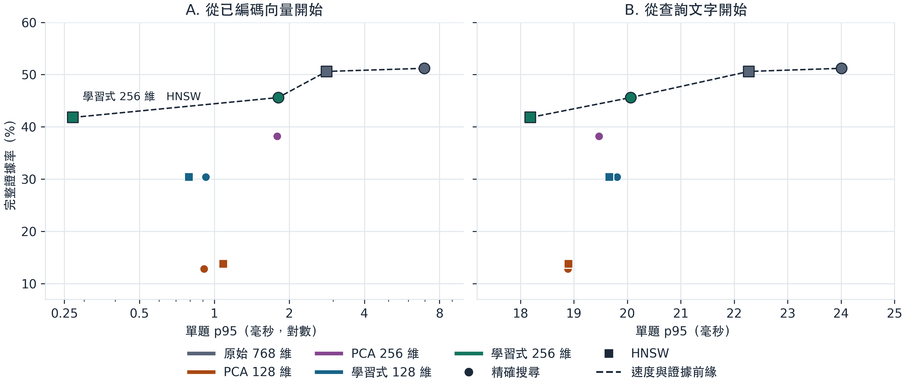

# 實驗結果與重現步驟

[報告摘要](README.md) · [繁體中文報告](paper/PAPER.zh-TW.md) · [English report](paper/PAPER.en.md)

## 目前有哪些測試成績？

### 最終階段 HotpotQA，500 題與 10 萬段

**同為 256 維精確搜尋，學習式投影比 PCA 多找齊 37 題。** 學習式找齊 228 題（45.6%），PCA 找齊 191 題（38.2%），配對差值為 **+7.4 個百分點 [4.0, 10.6]**。原始 768 維精確的完整證據率為 51.2%。



越靠左上，檢索越快且證據越完整。**學習式 256 維 HNSW 在兩種計時方式下都最快**，已編碼單題 p95 為 0.270 毫秒，含編碼為 18.19 毫秒，完整證據率為 41.8%。學習式投影仍未通過預設的證據保留門檻，原始 768 維 HNSW 的 50.6% 則是唯一達標的替代設定。兩種計時皆止於取得段落 ID。 [完整結果與錯誤案例](HOTPOTQA_RESULTS.md) · [配對區間](artifacts/phase4-report-pca256/summary.json)

### 第三階段 TREC 正式測試，3 萬至 30 萬段

**30 萬段的主要比較中，學習式 128 維精確搜尋的 nDCG@10 為 0.5182，PCA 128 維為 0.3268。** 兩者差值為 +0.1914，按查詢配對的 95% 區間為 [+0.1501, +0.2331]。2019 與 2020 分年比較的差值區間也都高於零。兩者的 Recall@10 分別為 0.2403 與 0.1182。測試使用兩年合計 97 題，搜尋深度在 MS MARCO 開發集上預先鎖定。[分年結果與六種方法的成績](artifacts/phase3-report/results.md)

學習式 128 維精確搜尋與原始 768 維 HNSW 在三個規模都通過 TREC 的共同品質門檻。下表計時從已編碼的查詢向量開始，取前 10 段。比值小於 1 表示學習式精確搜尋較快。

| 段落數 | 學習式精確 p95（ms） | 原始 HNSW p95（ms） | p95 比值 [95% 區間] | 批次 32 吞吐量（學習式精確 / 原始 HNSW，每秒查詢數） |
| ---: | ---: | ---: | --- | ---: |
| 30,000 | 0.272 | 0.841 | 0.323 [0.065, 0.356] | 32,317 / 1,528 |
| 100,000 | 0.899 | 2.515 | 0.357 [0.333, 0.379] | 9,878 / 504 |
| 300,000 | 2.673 | 2.959 | 0.903 [0.866, 0.909] | 3,460 / 428 |

**3 萬與 10 萬段支持學習式精確搜尋至少降低 10% 的單筆 p95。** 在 30 萬段，五輪 p95 的中位數相差 0.286 毫秒，比值區間上界 0.909，超過預設的 0.90。三個測點仍無法界定原始 HNSW 反超的區間。批次 32 時，學習式精確搜尋在 30 萬段仍可達每秒 3,460 題。若改為學習式 128 維 HNSW，30 萬段鎖定深度 64 的 nDCG@10 為 0.5179，單筆 p95 為 0.236 毫秒。[各規模的延遲與品質曲線](artifacts/phase3-report/quality-latency.png) · [全部操作點與批次結果](artifacts/phase3-report/operating-points.csv)

30 萬段的學習式精確索引占 153.6 MB，建置耗時 0.020 秒，載入後程序 RSS 增加 153.8 MB。原始 HNSW 占 1,003.2 MB，建圖耗時 275.8 秒，載入後 RSS 增加 1,003.6 MB。這些秒數從已有文件向量開始計算。投影主模型選中設定前五輪的訓練更新另耗時 0.376 秒，編碼、驗證與其他超參數試驗另計。[各規模的建置、檔案與載入成本](artifacts/phase3-report/index-costs.csv) · [訓練紀錄](artifacts/projection/summary.json)

全庫有 8,841,823 段，光是 768 維 float32 向量就需要 25.30 GiB。本機 Apple M3 有 24 GiB 統一記憶體，原始 HNSW 還要容納圖連結和建圖工作空間。全庫的同規模開發校準與常駐索引複核留待更大記憶體的主機。縮樣語料固定保留全部已判定段落，三個規模的占比分別是 67.83%、20.35% 和 6.783%，上述速度優勢僅適用於實測條件。[全庫資源評估與配對區間](artifacts/phase3-report/analysis.json) · [逐題計分核對](artifacts/phase3-report/verification.json)

### TREC 測試集，3 萬段

第一階段測了原始向量和 PCA，各用兩種搜尋方式。精確搜尋會逐段比對。HNSW 用圖索引加快搜尋。下表是 TREC 2019 的 43 題和 2020 的 54 題，合計 97 題的平均。當時兩組 HNSW 都用 `M=32`、`efSearch=128` 找前 10 或前 100 段。[TREC 分年與合併成績](artifacts/baseline-trec-30000/summary.json)

| 搜尋方法 | nDCG@10 | Recall@10 | Recall@100 | p95（ms） |
| --- | ---: | ---: | ---: | ---: |
| 768 維精確 KNN | 0.4824 | 0.2252 | 0.7262 | 2.062 |
| 768 維 HNSW | 0.4747 | 0.2149 | 0.7165 | 0.418 |
| 128 維 PCA + 精確 KNN | 0.3709 | 0.1379 | 0.5988 | 0.267 |
| 128 維 PCA + HNSW | 0.3709 | 0.1379 | 0.5963 | 0.083 |

**怎麼看這張表？** nDCG@10 衡量前十名的排序，越相關的段落越靠前，分數就越高。Recall@10 是「這題所有已標為相關的段落，有多少比例出現在前十名」，Recall@100 則看前一百名。TREC 用人工分級原分數算 nDCG，把 2、3 分算進 Recall。p95 越小越快，表中數字是單筆查詢取前 10 段時，各輪第 95 百分位耗時的五輪中位數。[NIST 相關性分級](https://trec.nist.gov/data/deep2019.html) · [trec_eval 計分方式](https://github.com/usnistgov/trec_eval/blob/main/m_ndcg_cut.c)

### MS MARCO 開發集，30 萬段

這是第二階段驗證模型時的數字。三種方法都對同一批 500 個問題做精確搜尋。把向量縮到 128 維後，學習式投影比 PCA 找回更多相關段落，兩者的 Recall@10 分別為 71.30% 和 41.53%。原始 768 維向量為 76.70%。開發集和上表的 TREC 使用不同問題與標註，應在各表內比較方法。[30 萬段開發集結果](artifacts/phase2-dev-300000/summary.json)

| 向量 | nDCG@10 | Recall@10 |
| --- | ---: | ---: |
| 原始 768 維 | 0.5797 | 0.7670 |
| PCA 128 維 | 0.2949 | 0.4153 |
| 學習式 128 維 | 0.5663 | 0.7130 |

### 哪些訓練選擇有影響？3 萬段開發集

這次在同一批 500 個開發問題上做精確搜尋，每次只換一項條件。下表的學習式模型都用學習率 0.001、溫度 0.07 和第 5 輪的權重。128 維主模型共有 98,304 個可訓練參數。[各次訓練與分數](artifacts/projection/summary.json) · [主模型權重](artifacts/projection/learned128.npz)

| 表示 | nDCG@10 | Recall@10 |
| --- | ---: | ---: |
| 原始 768 維 | 0.8157 | 0.9230 |
| PCA 64 維 | 0.2623 | 0.3593 |
| 學習式 64 維 | 0.6632 | 0.7840 |
| PCA 128 維 | 0.5102 | 0.6690 |
| 學習式 128 維（主模型） | 0.7797 | 0.8870 |
| 學習式 128 維，隨機初始化 | 0.7580 | 0.8640 |
| 學習式 128 維，僅批次內負例 | 0.7921 | 0.9070 |
| PCA 256 維 | 0.7289 | 0.8640 |
| 學習式 256 維 | 0.8318 | 0.9420 |

- **維度。** 在 64、128、256 維的三次比較中，學習式投影的分數都高於同維度的 PCA。128 維時，nDCG@10 高出 0.2694，Recall@10 高出 0.2180。
- **起始權重。** 從 PCA 權重開始訓練，nDCG@10 比從隨機權重開始高 0.0217。
- **負例。** 只用同批其他題目的段落當負例，nDCG@10 為 0.7921。再加入 BM25 找到的、用字相近但未標為正例的段落後，分數降低 0.0124。

固定已選好的模型後，我把同一題在兩種方法下的分數配成一對，重抽 10,000 次來估計差距。主模型相對於 PCA 的 nDCG@10 差距，95% 區間為 [0.2365, 0.3019]。起始權重和負例的差距區間都包含零，這批題目還不足以判定哪個選擇較好。這次重抽使用的也是選參數的開發題。正式比較沿用研究計畫指定的 PCA 起始權重和 BM25 負例。[配對差距與區間](artifacts/projection/paired-dev.json) · [重跑與排名核對](artifacts/projection/verification.json)

## 正式測試採用哪些搜尋設定？

**已經在 MS MARCO 開發集比較過。** 正式測試使用 TREC 的題目。主要比較是在 30 萬段裡，用精確搜尋逐段打分，看 128 維學習式投影和 128 維 PCA 哪個排得好。只有改用 HNSW 加速搜尋時，才需要挑下面的搜尋深度。

以「從 30 萬段找出前 10 段」為例。`k=10` 決定最後回傳幾段。`efSearch` 控制 HNSW 搜尋時保留多少候選項目，數字越大，通常找得越仔細、花的時間也越長。下表用同一個學習式 128 維模型、同樣的 500 道開發題，只改搜尋深度。[七組實測結果](artifacts/phase2-dev-300000/summary.json)

| 搜尋深度 | nDCG@10（排名品質） | Recall@10（找回比例） | 單題 p95（毫秒） |
| ---: | ---: | ---: | ---: |
| 10 | 0.5137 | 0.647 | 0.084 |
| 16 | 0.5341 | 0.673 | 0.106 |
| 32 | 0.5497 | 0.691 | 0.153 |
| 64 | 0.5670 | 0.713 | 0.254 |
| 128 | 0.5665 | 0.713 | 0.447 |
| 256 | 0.5664 | 0.713 | 0.829 |
| 512 | 0.5663 | 0.713 | 1.637 |

**為什麼選 64？** 這組的品質門檻是 nDCG@10 至少約 0.5697、Recall@10 至少 0.757。七個深度都沒有同時達標，因此按先訂好的規則，選 nDCG@10 最高的 64。從 64 加深到 512，找回比例仍是 0.713，p95 則從 0.254 增至 1.637 毫秒。這就是下表「64 回退」的意思。

下表列出各組正式測試採用的 `efSearch`。✓ 表示通過該組的開發集品質門檻。[各組鎖定設定](artifacts/phase2-lock.json)

| 段落數 | k | 原始 768 維 | PCA 128 維 | 學習式 128 維 |
| ---: | ---: | --- | --- | --- |
| 30,000 | 10 | 256 ✓ | 512 回退 | 128 回退 |
| 100,000 | 10 | 512 ✓ | 512 回退 | 256 回退 |
| 300,000 | 10 | 512 ✓ | 512 回退 | 64 回退 |
| 30,000 | 100 | 512 ✓ | 512 回退 | 128 ✓ |
| 100,000 | 100 | 512 ✓ | 512 回退 | 512 回退 |
| 300,000 | 100 | 512 回退 | 512 回退 | 256 回退 |

選擇深度時，先看結果品質，再看單筆查詢的 p95 耗時。

- **取前 10 段。** 跟同規模的原始 768 維精確搜尋相比，nDCG@10 和 Recall@10 最多各降 0.01。達標設定中選最快的。全部未達標就選 nDCG@10 最高的，同分時選最快的。
- **取前 100 段。** 計畫原先沒有指定詳細規則，這次用相同方式比較 Recall@100，容許降幅也是 0.01。全部未達標就選 Recall@100 最高的，同分時選最快的。
- **比較相近速度。** 在原始 HNSW 的 p95 上下 5% 以內，找出 Recall@10 最高的設定。三種規模裡，兩種 128 維 HNSW 都找不到落在這個範圍內的設定，因此對應欄位留空。

三種規模的學習式 128 維精確搜尋也都未通過共同品質門檻。目前無法從開發結果判定，在維持這個品質的前提下，段落增加到多少時兩種搜尋方法的速度優勢會互換。鎖定檔保存了權重雜湊、各組參數、開發集分數和五輪 p95 的中位數。108 組設定共 54,000 筆逐題排名都已重新計分並核對。[逐規模驗證](artifacts/phase2-verification.json)

## 如何重跑

以下步驟會產生 `artifacts/` 中的實驗輸出。報告圖檔放在 `paper/figures/`。

### 1. 安裝環境、放入資料

使用 Python 3.12，在專案目錄執行以下命令。

```bash
uv venv --python 3.12
uv pip install -r requirements.txt
mkdir -p data/raw
```

| 資料 | 放入 `data/raw/` 的檔案 |
| --- | --- |
| [MS MARCO Passage Ranking v1](https://microsoft.github.io/msmarco/Datasets.html) | `collection.tar.gz`、`queries.tar.gz`、`qrels.train.tsv`、`qrels.dev.tsv` |
| [TREC DL 2019 查詢](https://microsoft.github.io/msmarco/TREC-Deep-Learning-2019.html)、[2019 段落標註](https://trec.nist.gov/data/deep2019.html) | `msmarco-test2019-queries.tsv.gz`、`2019qrels-pass.txt` |
| [TREC DL 2020 查詢](https://microsoft.github.io/msmarco/TREC-Deep-Learning-2020.html)、[2020 段落標註](https://trec.nist.gov/data/deep2020.html) | `msmarco-test2020-queries.tsv.gz`、`2020qrels-pass.txt` |
| [HotpotQA 開發集](https://hotpotqa.github.io/)、[Wikipedia 導言庫](https://hotpotqa.github.io/wiki-readme.html) | `hotpot_dev_fullwiki_v1.json`、`hotpot_dev_distractor_v1.json`、`enwiki-20171001-pages-meta-current-withlinks-abstracts.tar.bz2` |

本機使用固定版本的 HotpotQA 鏡像，兩個 JSON 檔的 SHA-256 都與原始檔相同。[RAGLAB 鏡像](https://huggingface.co/datasets/RAGLAB/data/tree/9c3cbca5e7cb97f16c7cabf8fa6e8d1e871995d2/eval_datasets/HotPotQA) · [原始檔 checksum](https://huggingface.co/datasets/hotpotqa/hotpot_qa/blob/cb440e4e72efe5808fe5df497ffa0b4e8da85c32/dataset_infos.json)

Wikipedia 導言可以用原始壓縮檔、解壓後的目錄或固定版本鏡像。鏡像副檔名是 `.tsv`，實際上每行都是一筆 JSON，`text` 保留了該頁的句子陣列。[導言鏡像](https://huggingface.co/datasets/LovinYou/enwiki-20171001-pages-meta-current-withlinks-abstracts/tree/dd8699459339f9a9c9fd4e4d47d181fb70392ce6)

### 2. 準備查詢和段落

```bash
.venv/bin/python -m lrp prepare-marco
.venv/bin/python -m lrp prepare-hotpot \
  --fullwiki data/raw/hotpot_dev_fullwiki_v1.json \
  --distractor data/raw/hotpot_dev_distractor_v1.json \
  --wiki data/raw/enwiki-20171001-pages-meta-current-withlinks-abstracts.tar.bz2
```

**MS MARCO 與 TREC。** 同一道題如果出現在多份資料，就優先留在測試集，其次是開發集，最後才是訓練集。程式會比對查詢 ID，也會先統一文字的 Unicode 寫法（NFKC）、大小寫和空白再比對。兩年的官方測試題都參與查重，計分時只用有人工標註的題目。完整段落庫有 8,841,823 段。整理查詢時移除了 16 筆訓練查詢和 1 筆開發查詢，也合併了 10 筆分數相同的重複訓練標註。2019 年有 9,260 筆測試標註，2020 年有 11,386 筆。[資料切分統計](artifacts/marco/manifest.json)

開發集以固定種子 42 按雜湊值抽出 500 題，先保留這些題目的已標註段落。TREC 則保留兩年所有已判定段落。兩份段落庫都用同一套規則補入背景段落並固定順序，因此只要取各自檔案的前幾筆就能重建某個規模。第一階段準備了 3 萬、10 萬、50 萬段，其中 TREC 已判定的 20,349 段分別占 67.83%、20.35%、4.07%。

第二階段在開發語料編碼期間，把最大規模從 50 萬改為 30 萬，之後才做 30 萬段校準。兩份檔案各取前 300,000 段。開發集含 524 個已標註段落和 299,476 個背景段落，TREC 含 20,349 個已判定段落（6.783%）和 279,651 個背景段落。

**HotpotQA。** 從 7,405 題固定抽出 500 題，用題目 ID 到 distractor 開發集找到標註原文，再按照頁名、從 0 起算的句子位置和原文，逐句比對 Wikipedia 導言。比對時統一 Unicode 寫法（NFC）和空白，保留大小寫和標點。本機導言鏡像 `data/raw/hotpot-intros-mirror.jsonl` 有 5,233,329 頁，1,217 句標註證據都能對回原文，分布在 995 頁。保留這些頁面後，再按雜湊值抽樣補到 100,000 段。這項核對衡量的是證據能否在資料裡定位。檢索模型能找回多少證據，要另外評估。[資料核對結果](artifacts/hotpot/manifest.json) · [每題的證據位置與字元範圍](artifacts/hotpot/eval-hotpot.jsonl)

各份 `manifest.json` 都記錄了來源檔案的雜湊、切分統計，以及段落占比或證據對回原文的比例。`queries-train.jsonl` 保存去重後的訓練查詢與每題所有已知正例的 ID。

### 3. 重跑第一階段的基準

```bash
.venv/bin/python -m lrp baseline --split dev --passages 30000 --model-dir data/models/contriever \
  --out artifacts/baseline-dev-30000
.venv/bin/python -m lrp baseline --split trec --passages 30000 --model-dir data/models/contriever \
  --out artifacts/baseline-trec-30000
```

Contriever 使用固定版本，每段最多 128 tokens，只對 attention mask 標出的有效 token 取平均。上例從本機讀模型，省略 `--model-dir` 會從 Hugging Face 取得指定版本。程式依序嘗試 CUDA、Metal、CPU，也可以用 `--device` 指定。編碼結果以 float32 存在 `data/embeddings/` 的 SQLite 裡，依編碼設定和文字的 SHA-256 查找。中斷後重跑，可接著使用已存好的向量。[Contriever 模型版本](https://huggingface.co/facebook/contriever/tree/2bd46a25019aeea091fd42d1f0fd4801675cf699)

搜尋前先把向量長度調成 1（L2 正規化）。PCA 用去重後的 2,048 個訓練查詢和 2,048 個不同的已標註正例段落，一起估計平均向量與主成分。輸出的 `pca.npz` 保存均值、主成分、解釋變異比例和樣本 ID，可用相同樣本重建。

原始 768 維和 PCA 128 維都用 CPU Faiss 做精確內積搜尋與 HNSW 搜尋。HNSW 用單執行緒建圖，預設 `M=32`、`efConstruction=200`，分別測試找前 10 段和前 100 段的合法搜尋深度。10 萬段的基準程式也支援 `M=16` 和 `M=48`，第三階段已實測這三種連結數。輸出目錄包含索引、每題的排名和分數、建索引時間、檔案大小、五輪延遲及吞吐量。單筆耗時從已編碼的向量算起，另記純 Faiss 搜尋耗時和每批 32 題的吞吐量。

要查看排名變化，可以逐題比對 HNSW 和同一組向量的精確搜尋，也可以比對 PCA 和原始 768 維的精確搜尋。重新載入索引時，以 `passage-ids.jsonl` 將位置轉回段落 ID，並設好要使用的 `efSearch`。第一階段開發集與 TREC 基準使用的 PCA 均值、主成分及訓練 ID 完全相同。用 NIST `trec_eval` v9.0.8 核對 nDCG 和 Recall，160 次比較在四位小數精度內一致。[第一階段開發集結果](artifacts/baseline-dev-30000/summary.json) · [開發集驗證](artifacts/baseline-dev-30000/verification.json) · [TREC 驗證](artifacts/baseline-trec-30000/verification.json)

### 4. 重跑投影訓練、開發集評估與設定選擇

從第一階段的 `artifacts/marco` 開始，沿用同一個 Contriever、128-token 上限和向量快取。下例用本機 Apple GPU 編碼，用單執行緒 CPU 訓練投影和執行 Faiss 搜尋。若已經有實驗結果，請在新輸出路徑重跑，以保留原先鎖定的版本。

```bash
.venv/bin/python -m lrp prepare-projection
.venv/bin/python -m lrp train-projection --model-dir data/models/contriever --device mps
for size in 30000 100000 300000; do
  .venv/bin/python -m lrp calibrate-projection --passages "$size" \
    --model-dir data/models/contriever --device mps --out "artifacts/phase2-dev-$size" || break
done
.venv/bin/python -m lrp lock-projection --calibration \
  artifacts/phase2-dev-30000 artifacts/phase2-dev-100000 artifacts/phase2-dev-300000
```

**挑訓練例子。** 以種子 42 按雜湊值抽出 8,192 個訓練問題。先放入這些問題所有已知的正例段落，再從其他帶有訓練正例標註的段落抽樣，湊成 32,768 段。每題用 SQLite FTS5 的 BM25 從中挑出最多 4 個用字相近、但未被標為該題正例的段落。2 題找不到合適負例，所以各組都用相同的 8,190 題。抽到的查詢、正例、負例與段落池 ID 都有保存。[訓練資料清單](artifacts/projection-data/manifest.json)

**訓練投影。** 用第一階段兩組各 2,048 個向量算出共同均值與前 256 個 PCA 主成分。查詢和段落都先把向量長度調成 1、減去均值，再乘上同一組投影權重，最後把長度調回 1。每批訓練 128 題，有多個正例的題目按 ID 順序逐輪替換。批次內會移除重複段落、遮住其餘已知正例，避免把它們當成負例。主模型另外加入每題的 BM25 負例。

**選訓練設定。** 在 3 萬段的開發集上做精確搜尋，比較學習率 `{0.0003, 0.001}`、溫度 `{0.03, 0.07}` 及第 1 到第 6 輪的模型。先比 nDCG@10，同分比 Recall@10，再依序選較早輪次、較低學習率、較低溫度。比較維度、起始權重和負例時，其餘訓練設定、批次順序和種子都相同。

**量搜尋速度。** 每個規模都用同一順序插入段落，以 `M=32`、`efConstruction=200` 建圖。取前 10 段時試七個搜尋深度，取前 100 段時試 128、256、512。每輪都用固定種子打亂設定和題目的順序，先暖機，再從單筆已編碼向量計時到回傳段落 ID，用五輪 p95 的中位數比較速度。

### 5. 重跑第三階段 TREC 正式測試

在專案根目錄使用第二階段鎖定檔。建圖與計時可分開執行。下例將重跑結果放在新目錄，先建完全部索引，再依序量測，避免其他建圖作業影響延遲。

```bash
(
  set -e
  results=artifacts/phase3-rerun
  for step in build measure; do
    for size in 30000 100000 300000; do
      .venv/bin/python -m lrp "phase3-$step" --passages "$size" \
        --model-dir data/models/contriever --device mps --out "$results/phase3-trec-$size"
    done
  done
  .venv/bin/python -m lrp phase3-report --results "$results" --out "$results/report"
)
```

加上 `phase3-report --trec-eval /path/to/trec_eval` 的選項，可用本機的 NIST 計分器逐題複核。索引目錄包含段落 ID 對照、Faiss 檔、建置秒數、每題的排名與分數，以及相對同表示精確搜尋的近鄰召回率。其下的 `measurement/` 保留兩種批次的實際排名、逐輪效能和測試順序。原始向量與投影均讀取第二階段所用的編碼器設定。即時查詢編碼需能使用設定中的裝置，本次為 Metal GPU。

單筆與批次 32 都從已編碼查詢開始，計入正規化、投影、搜尋和段落 ID 對照。每輪固定種子打亂配置與查詢順序。97 題無法整除 32，最後一批從當輪開頭補滿，吞吐量以 128 次實際查詢計算，品質只計每題第一次出現的排名。批次 p95 的單位為每批毫秒。單筆純索引時間另測，六種方法鎖定的 top-10 操作點另從查詢文字直接量到段落 ID。建索引時間從建立空索引到加完向量，離線編碼與投影在計時前完成。

### 6. 重跑第四階段 HotpotQA 證據與答案評估

使用第 2 節準備的 500 題與 100,000 段、第二階段的投影權重及鎖定檔。本次實測的 Wikipedia 輸入為 `--wiki data/raw/hotpot-intros-mirror.jsonl`。生成模型與斷詞器來自同一個公開快照，答案依 HotpotQA 官方 v1 評分程式計分。以下命令從專案根目錄執行。[模型快照](https://huggingface.co/Qwen/Qwen2.5-0.5B-Instruct/tree/7ae557604adf67be50417f59c2c2f167def9a775) · [官方評分程式版本](https://github.com/hotpotqa/hotpot/blob/3635853403a8735609ee997664e1528f4480762a/hotpot_evaluate_v1.py)

```bash
(
  set -e
  uv pip install -r requirements.txt
  model=data/models/qwen2.5-0.5b-instruct
  revision=7ae557604adf67be50417f59c2c2f167def9a775
  mkdir -p "$model" data/official data/nltk/corpora
  curl -fLsS --retry 3 https://raw.githubusercontent.com/nltk/nltk_data/550b6625bcef1f2abff2ff770a5a0d272c9c6b2a/packages/corpora/wordnet.zip -o data/nltk/corpora/wordnet.zip
  for file in config.json generation_config.json merges.txt model.safetensors tokenizer.json tokenizer_config.json vocab.json; do
    curl -fLsS --retry 3 "https://huggingface.co/Qwen/Qwen2.5-0.5B-Instruct/resolve/$revision/$file" -o "$model/$file"
  done
  curl -fLsS --retry 3 https://raw.githubusercontent.com/hotpotqa/hotpot/3635853403a8735609ee997664e1528f4480762a/hotpot_evaluate_v1.py -o data/official/hotpot_evaluate_v1.py
)
```

```bash
(
  set -e
  run=artifacts/phase4-rerun
  .venv/bin/python -m lrp phase4-retrieve --out "$run/retrieval"
  .venv/bin/python -m lrp phase4-controls --out "$run/controls"
  .venv/bin/python -m lrp phase4-answer --retrieval "$run/retrieval" --out "$run/answers"
  .venv/bin/python -m lrp phase4-report --retrieval "$run/retrieval" --answers "$run/answers" \
    --controls "$run/controls" --out "$run/report"
  .venv/bin/python -m unittest discover -s tests
)
```

檢索沿用訓練時的 Contriever 設定，本機使用 Metal、float32、每批 64 筆、每段最多 128 tokens，編碼 Wikipedia 導言正文。六組檢索均取前十段，讀入生成模型的內容依名次串接頁名、換行及原始正文，段與段之間空一行。頁名與分隔符計入 2,048-token 預算，題目、指令與聊天模板另外編碼。若預算切在一個 Unicode 字元中間，回退到上一個完整字元。證據須同時符合標註的頁面、句子索引及完整文字範圍。無法映射的句子保留在主評估分母。

僅問題對照的上下文為空，標註證據對照依頁名分組，按句子索引放入標註原句。兩者與六種檢索條件均採 Qwen2.5-0.5B-Instruct，Metal 上以 float16、每批四筆、貪婪解碼，最多產生 32 個新 tokens。所有條件使用相同提示，直接對生成結果做官方 EM、token F1 評分。相同輸入 token 序列共用答案，生成快取按模型設定及整批提示識別，中斷可從已完成的批次繼續。若要獨立重做推論，為兩個生成指令指定新的 `--generation-cache` 目錄。

每個階段會寫入新的輸出目錄。`retrieval/` 保存六組 Faiss 索引、段落 ID 與逐題排名。`answers/` 和 `controls/` 保存逐題實際可見的上下文、證據狀態、提示雜湊與模型原始答案，以及各批生成秒數。`report/` 保存逐題分數、可送入官方評分器的輸入、完整映射子集、配對區間與核對結果。評分可獨立重跑，無需重新編碼或生成。

英文 METEOR 另以 NLTK 3.9.2 的單一參考答案實作計算。原始答案與預測各自使用 TreebankWordTokenizer 斷詞，保留標點，然後轉小寫。匹配使用 Porter 詞幹與英文 WordNet 3.0，參數為 α=0.9、β=3.0、γ=0.5。每題先計分再取平均，空預測為 0。碎片懲罰使完全相符的單詞答案（例如 yes）得到 0.5，此指標應在相同題目上比較方法。重算已生成的答案只需執行最後的 `phase4-report` 指令並指定新輸出目錄。[NLTK METEOR 定義](https://www.nltk.org/api/nltk.translate.meteor_score.html) · [WordNet 固定快照](https://github.com/nltk/nltk_data/blob/550b6625bcef1f2abff2ff770a5a0d272c9c6b2a/packages/corpora/wordnet.zip)

**256 維追加比較。** 以下命令承接上例的 `artifacts/phase4-rerun`。學習式投影使用同次訓練的 `learned256.npz`，並在 MS MARCO 10 萬段開發集選定 HNSW 深度。PCA 精確搜尋使用已鎖定的 `pca.npz` 全部 256 個主成分。各組共用同一批 HotpotQA 問題、語料及生成設定。合併報表包含九種檢索方法、兩個對照，以及同維度學習式投影相對 PCA 的配對差值。計時在答案生成完成後一併重測九組。

```bash
(
  set -e
  run=artifacts/phase4-rerun
  .venv/bin/python -m lrp phase4-calibrate256 --out "$run/dev256"
  .venv/bin/python -m lrp phase4-retrieve --calibration256 "$run/dev256/lock.json" --out "$run/retrieval256"
  .venv/bin/python -m lrp phase4-answer --retrieval "$run/retrieval256" --out "$run/answers256"
  .venv/bin/python -m lrp phase4-retrieve --pca256 --out "$run/retrieval-pca256"
  .venv/bin/python -m lrp phase4-answer --retrieval "$run/retrieval-pca256" --out "$run/answers-pca256"
  .venv/bin/python -m lrp phase4-report --retrieval "$run/retrieval" --answers "$run/answers" \
    --controls "$run/controls" --retrieval256 "$run/retrieval256" --answers256 "$run/answers256" \
    --retrieval-pca256 "$run/retrieval-pca256" --answers-pca256 "$run/answers-pca256" \
    --out "$run/report-with-256"
  .venv/bin/python -m lrp phase4-timing --retrieval "$run/retrieval" --retrieval256 "$run/retrieval256" \
    --retrieval-pca256 "$run/retrieval-pca256" --report "$run/report-with-256" --out "$run/timing"
)
```

HotpotQA 計時在生成完成後單獨執行。完整 500 題量測已編碼查詢的單題 p50、p95 及 32 題批次吞吐量，另按固定雜湊抽取 100 題，直接量測從查詢文字編碼到傳回十個段落 ID 的單題 p95。各做五輪，固定種子輪換題目和方法順序，取逐輪 p95 的中位數，再按輪次配對估計延遲比值區間。

### 7. 重繪報告圖表

以第 5、6 節重跑的報表生成兩種語言的圖檔。若使用原始報表目錄，可省略這三個路徑選項。若需要指定繁體中文字型檔，可加上 `--zh-font`。

```bash
.venv/bin/python paper/make_figures.py \
  --trec-report artifacts/phase3-rerun/report \
  --hotpot-report artifacts/phase4-rerun/report-with-256 \
  --hotpot-timing artifacts/phase4-rerun/timing
```
