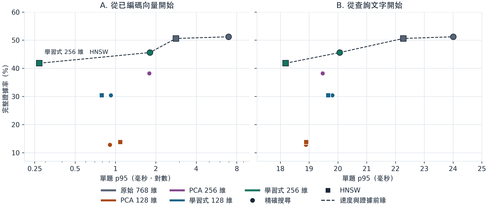

# HotpotQA 最終研究結果

個人獨立實驗補充紀錄 · **Yun-Yao(Paul) Lin**

在固定的 500 題及 10 萬段 Wikipedia 導言庫中，學習式 128 維精確搜尋找齊 152 題的全部支持句，較同維度 PCA 的 64 題多出 88 題。將學習式投影增加到 256 維後，找齊的題數達到 228 題（45.6%）。對照原始 768 維精確搜尋的 256 題，學習式 128 維的完整證據率少 20.8 個百分點，256 維少 5.6 個百分點。256 維差值的 95% 區間下界為 −9.4 個百分點，仍低於 −2.0 的證據保留門檻。 [逐題配對統計](artifacts/phase4-report-pca256/summary.json)

追加的 **PCA 256 維精確搜尋**找齊 191 題（38.2%）。同維度的學習式精確搜尋多找齊 37 題，差 +7.4 個百分點 [4.0, 10.6]。九組一併重測後，學習式 256 維 HNSW 的單題 p95 最低，已編碼為 0.270 毫秒，從文字到段落 ID 為 18.19 毫秒。若要求通過證據保留門檻，原始 768 維 HNSW 是唯一達標的替代設定。 [配對統計](artifacts/phase4-report-pca256/summary.json) · [九組延遲](artifacts/phase4-timing-pca256/timing.json)

越靠左越快，越高代表有更多題找齊支持句。虛線連接實測中速度與證據的最佳取捨。左圖從已編碼向量計時，右圖從查詢文字計時。

## 前十段提供了多少證據？

支持段落召回率按題計算前十名中涵蓋的標註頁面比例。支持句召回率按題計算生成上下文中完整可見的標註句比例，再對 500 題取平均。完整證據率只計入所有標註句均完整可見的題目。差值為各組減去原始 768 維精確搜尋，單位為百分點。以相同問題配對重抽 10,000 次，95% 區間下界達 −2.0 個百分點即通過門檻。

| 方法 | 支持段落召回率 | 支持句召回率 | 完整證據題數 | 完整證據率 | 相對基準差值 [95% 區間] | 達標 |
| --- | ---: | ---: | ---: | ---: | ---: | --- |
| 原始 768 維精確 | 72.90% | 73.30% | 256/500 | 51.2% | 0.0 [0.0, 0.0] | 基準 |
| 原始 768 維 HNSW | 72.20% | 72.60% | 253/500 | 50.6% | −0.6 [−1.4, 0.0] | 是 |
| PCA 128 維精確 | 32.30% | 32.56% | 64/500 | 12.8% | −38.4 [−42.8, −34.0] | 否 |
| PCA 128 維 HNSW | 32.50% | 32.77% | 69/500 | 13.8% | −37.4 [−41.8, −33.0] | 否 |
| PCA 256 維精確（追加） | 62.70% | 63.19% | 191/500 | 38.2% | −13.0 [−16.6, −9.2] | 否 |
| 學習式 128 維精確 | 55.20% | 55.69% | 152/500 | 30.4% | −20.8 [−25.2, −16.6] | 否 |
| 學習式 128 維 HNSW | 55.10% | 55.59% | 152/500 | 30.4% | −20.8 [−25.2, −16.6] | 否 |
| 學習式 256 維精確（追加） | 69.10% | 69.53% | 228/500 | 45.6% | −5.6 [−9.4, −1.8] | 否 |
| 學習式 256 維 HNSW（追加） | 64.00% | 64.28% | 209/500 | 41.8% | −9.4 [−13.2, −5.6] | 否 |

同為精確搜尋，96 題只有學習式投影找齊證據，8 題只有 PCA 找齊，淨增 88 題，差值為 +17.6 個百分點，95% 區間為 [+14.0, +21.4]。改與原始精確搜尋比較，122 題只有原始表示找齊，18 題只有學習式投影找齊。在原始向量空間改用鎖定的 HNSW，失去完整證據的只有 3 題。[六組排名與搜尋設定](artifacts/phase4-retrieval/manifest.json)

九個索引分別重新載入後，以同一批查詢向量重播搜尋，4,500 份 top-10 排名與分數逐筆一致。另從每題保存的上下文核對原文與支持句位置，並將可見支持句集合交給官方評分器複算召回率與完整率。此處的支持句集合來自標註與上下文的交集。[逐組官方核對](artifacts/phase4-report-pca256/verification.json)

### 學習式投影從 128 維增加到 256 維

固定精確搜尋時，256 維讓 82 題新取得完整證據，另有 6 題失去完整證據，淨增 76 題。完整證據率比 128 維高 15.2 個百分點，配對 95% 區間為 [+11.8, +18.6]。線性投影的權重數從 98,304 增為 196,608。10 萬段的精確索引由 51.2 MB 增為 102.4 MB，原始 768 維精確索引為 307.2 MB。與原始表示相比，33 題只有 256 維找齊，61 題只有 768 維找齊。[256 維索引與操作點](artifacts/phase4-retrieval-256/manifest.json)

256 維 HNSW 在相同規模 MS MARCO 開發集上掃描七種搜尋深度。原始精確搜尋的 nDCG@10 為 0.7011、Recall@10 為 0.8510，兩項容許降幅均為 0.01。通過門檻的最快操作點為 efSearch=32，nDCG@10 為 0.7174、Recall@10 為 0.8510。將此設定移到 HotpotQA，取得完整證據的題數由同表示精確搜尋的 228 題降至 209 題。與 128 維 HNSW（efSearch=256）比較的差值為 +11.4 個百分點 [+8.0, +15.0]，包含投影維度與已選搜尋深度兩項變動。這是看到 128 維結果後追加的比較，256 維的投影訓練與搜尋深度選擇均未使用 HotpotQA 答案。[七個開發操作點與選擇紀錄](artifacts/phase4-dev-256/lock.json)

### 256 維下，學習式投影比 PCA 多找齊 37 題

在同一批 500 題與 10 萬段中追加 PCA 256 維精確搜尋，使用原先在 MS MARCO 訓練資料擬合的 256 個主成分、同一個 Contriever 編碼器及相同上下文預算。PCA 256 維找齊 191 題（38.2%）。同維度的學習式精確搜尋找齊 228 題（45.6%），差 **+7.4 個百分點 [4.0, 10.6]**。55 題只有學習式投影找齊，18 題只有 PCA 找齊。PCA 從 128 維升到 256 維也多找齊 127 題，增加 25.4 個百分點 [21.6, 29.4]。兩種 256 維精確搜尋都未通過相對原始 768 維的證據保留門檻。[追加組索引與權重](artifacts/phase4-retrieval-pca256/manifest.json) · [配對結果](artifacts/phase4-report-pca256/summary.json)

## 答案品質與錯誤分布

所有條件使用同一批參考答案。EM 與 token F1 使用 HotpotQA 官方 v1 程式。英文 METEOR 使用 NLTK 3.9.2、Treebank 斷詞與 WordNet 3.0，每題採單一參考答案。表內分數為 0–1。最後兩欄是各組內的題數，「未匹配」按官方 EM 判定。[逐題分數與配對區間](artifacts/phase4-report-pca256/summary.json) · [METEOR 計分定義](https://www.nltk.org/api/nltk.translate.meteor_score.html)

| 條件 | EM | token F1 | METEOR | 證據齊全但 EM=0 | 證據不全但 EM=1 |
| --- | ---: | ---: | ---: | ---: | ---: |
| 僅問題 | 0.0860 | 0.1486 | 0.1164 | 0 | 43 |
| 僅標註證據與問題 | 0.4500 | 0.6001 | 0.4706 | 275 | 0 |
| 原始 768 維精確 | 0.2320 | 0.3294 | 0.2731 | 168 | 28 |
| 原始 768 維 HNSW | 0.2360 | 0.3321 | 0.2748 | 164 | 29 |
| PCA 128 維精確 | 0.1480 | 0.2147 | 0.1761 | 48 | 58 |
| PCA 128 維 HNSW | 0.1500 | 0.2230 | 0.1797 | 49 | 55 |
| PCA 256 維精確（追加） | 0.2440 | 0.3247 | 0.2696 | 124 | 55 |
| 學習式 128 維精確 | 0.1980 | 0.2699 | 0.2272 | 104 | 51 |
| 學習式 128 維 HNSW | 0.1980 | 0.2697 | 0.2271 | 104 | 51 |
| 學習式 256 維精確（追加） | 0.2540 | 0.3427 | 0.2928 | 143 | 42 |
| 學習式 256 維 HNSW（追加） | 0.2660 | 0.3444 | 0.2904 | 125 | 49 |

在 128 維精確搜尋下，學習式相對 PCA 的 EM 高 0.0500 [0.0160, 0.0840]，token F1 高 0.0553 [0.0218, 0.0907]，METEOR 高 0.0510 [0.0227, 0.0798]。原始精確搜尋證據齊全的 256 題中，88 題達到 EM，168 題未匹配。另有 28 題在標註證據不全時仍達到 EM。答案匹配程度與標註證據齊全程度需要分開解讀。

256 維精確搜尋相對 128 維精確搜尋的 EM 高 0.0560 [0.0260, 0.0880]，F1 高 0.0728 [0.0427, 0.1030]，METEOR 高 0.0657 [0.0408, 0.0912]。相對原始 768 維精確搜尋，三項差值依序為 +0.0220 [−0.0100, +0.0540]、+0.0133 [−0.0170, +0.0432]、+0.0197 [−0.0036, +0.0434]。點估計均略高，三個區間均包含零。本研究預設的 2 個百分點門檻用於完整證據率，答案品質未預設等效門檻。

六種主要方法的 3,000 份檢索上下文介於 256–1,733 tokens，均在預算內。原始、PCA、學習式精確搜尋分別漏掉 333、822、542 句標註支持句，原因全是支持頁未進前十名。追加的 256 維精確與 HNSW 分別漏掉 379、443 句，也全是支持頁未進前十名。這批短導言無法估計長文件情境的截斷損失。[逐題上下文與答案](artifacts/phase4-answers)

## 相同問答語料下的速度與品質取捨

單題檢索時間從已編碼的 768 維查詢開始，涵蓋正規化、投影、搜尋及回傳十個頁面 ID。每輪使用同一批 500 題，輪換方法順序，單執行緒執行已暖機的 CPU Faiss 索引。批次 32 另計每秒查詢數，每輪最後一批補滿至 512 次查詢。另以固定抽取的 100 題直接計時從文字、Metal 即時編碼到頁面 ID 的單題延遲。追加 PCA 256 維後，九組重新在同一批五輪中量測。表列各輪 p95 或吞吐量的中位數。[逐輪結果、測試順序與配對區間](artifacts/phase4-timing-pca256/timing.json)

| 方法 | 完整證據率 | 答案 F1 | 已編碼單題 p95（ms） | 相對原始精確加速 | 含編碼單題 p95（ms） | 批次 32（題/秒） |
| --- | ---: | ---: | ---: | ---: | ---: | ---: |
| 原始 768 維精確 | 51.2% | 0.3294 | 6.967 | 1.00× | 24.01 | 2,998 |
| 原始 768 維 HNSW | 50.6% | 0.3321 | 2.822 | 2.47× | 22.27 | 402 |
| PCA 128 維精確 | 12.8% | 0.2147 | 0.908 | 7.67× | 18.89 | 9,657 |
| PCA 128 維 HNSW | 13.8% | 0.2230 | 1.086 | 6.42× | 18.90 | 1,354 |
| PCA 256 維精確（追加） | 38.2% | 0.3247 | 1.787 | 3.90× | 19.47 | 6,799 |
| 學習式 128 維精確 | 30.4% | 0.2699 | 0.925 | 7.53× | 19.81 | 9,738 |
| 學習式 128 維 HNSW | 30.4% | 0.2697 | 0.790 | 8.82× | 19.67 | 1,418 |
| 學習式 256 維精確（追加） | 45.6% | 0.3427 | 1.804 | 3.86× | 20.06 | 6,766 |
| 學習式 256 維 HNSW（追加） | 41.8% | 0.3444 | 0.270 | 25.76× | 18.19 | 4,936 |

- **保留最多證據的低延遲替代設定。** 原始 768 維 HNSW 比原始精確少 3 題完整證據，差值區間下界為 −1.4 個百分點，通過原訂 −2.0 的門檻。已編碼 p95 從 6.967 降到 2.822 毫秒，加速 2.47 [2.41, 2.49] 倍。
- **固定 256 維精確搜尋。** PCA 與學習式投影的已編碼 p95 分別為 1.787 及 1.804 毫秒，完整證據率分別為 38.2% 與 45.6%。
- **單題最快的設定。** 學習式 256 維 HNSW 相對原始精確搜尋的已編碼 p95 加速 25.76 [25.40, 26.12] 倍，從文字起算加速 1.32 [1.16, 1.53] 倍，完整證據少 47 題。答案 F1 差值為 +0.0150 [−0.0157, +0.0462]。批次 32 時，學習式 256 維精確搜尋的吞吐量高於同維度 HNSW。

品質取自生成時保存的排名。與計時首輪排名相比，單題搜尋有一筆學習式 128 維 HNSW 的第 8、9 名互換，前十段集合一致，批次 32 全部排名一致。延遲比值區間反映同一部 Apple M3 在五輪量測中的變動。計時止於取得段落 ID，答案生成另計。[含答案 F1 的延遲圖](artifacts/phase4-timing-pca256/quality-latency.png)

## 個案複核

以下案例按問題 ID 比對前十名、可見的支持原句、生成答案與參考答案。案例用於解釋不同失誤，頻率以全體 500 題的統計為準。[標註原句與位置](artifacts/hotpot/eval-hotpot.jsonl) · [原始精確逐題結果](artifacts/phase4-report/raw768-flat-scores.jsonl) · [學習式精確逐題結果](artifacts/phase4-report/learned128-flat-scores.jsonl)

| 問題 ID 與題意 | 複核結果 |
| --- | --- |
| `5a8f0a01554299458435d539`，《Telos》的樂團在哪座城市成立？ | 原始精確搜尋找回專輯頁與樂團頁，模型答 Indianapolis。學習式精確搜尋只找回專輯頁，留下樂團名 Forevermore，缺少樂團來自 Indianapolis 的支持句。模型回答了樂團名。256 維精確搜尋把專輯頁和樂團頁排在第一與第三名，模型回答 Indianapolis, Indiana。參考答案只有城市名，額外的州名使 EM 為 0。 |
| `5a7651825542992d0ec060a3`，哪所大學的學校數較多？ | 原始精確搜尋讓四句證據全部可見，模型仍選 University of Rochester。PCA 精確搜尋只找回 Rochester 的一句。只給標註證據時，模型答對 Ateneo de Davao University。這一題中，完整導言與僅標註句的答案不同。 |
| `5ac3d10b5542993915413952`，哪位網球選手來自巴西？ | 原始精確搜尋找齊兩句，模型回答 Maria Bueno，對應到參考答案 Maria Esther Andion Bueno 的同一位選手。官方 EM 為 0，token F1 為 0.667。精確匹配失敗包含這類姓名形式差異。 |
| `5a83dd2c554299334474609e`，列出與一位德國攝影師合作的五名演員。 | 三種精確搜尋都漏掉兩個支持頁。標註證據對照提供了五人完整名單，模型先重述題目，32-token 輸出在第四個姓名中途結束。這是生成長度上限帶來的漏答，輸入的支持句完整可見。 |

## 語料、生成設定與適用範圍

- **抽樣。** 從 HotpotQA fullwiki 開發集的 7,405 題以種子 42 選取 500 題。這些題目的 1,217 句標註均已映射，主報告與完整映射子集使用同一批 500 題。語料優先保留 995 個支持頁，再加入 99,005 個背景頁。結果適用於這份固定語料。完整導言庫共有 5,233,329 頁，干擾頁分布與本實驗不同。[抽樣與映射清單](artifacts/hotpot/manifest.json)
- **檢索。** 使用在 MS MARCO 上訓練的投影，維持 Contriever 的 128-token 正文編碼上限。HNSW 均使用 M=32、efConstruction=200、種子 42 與單執行緒建圖。10 萬段時鎖定的 efSearch 依原始、PCA、學習式順序為 512、512、256。六組共用語料插入順序、問題、前十名上限及 2,048-token 生成內容預算。[第二階段鎖定檔](artifacts/phase2-lock.json)
- **生成與統計。** 計畫未指定生成模型，本次固定使用 Qwen2.5-0.5B-Instruct，以同一提示貪婪解碼，最多產生 32 個新 tokens。題目及指令另計。答案指標取逐題平均，區間反映在這批題目上的抽樣差異。六組主要檢索條件共用 1,887 個相異提示，模型生成各批累計 1,712 秒。兩個對照的 1,000 個提示累計 1,322 秒，追加兩組的 851 個相異提示累計 906 秒。以上為各批實際生成秒數加總，相同輸入共用結果。單一模型、提示與輸出上限會影響答案品質。EM 採官方字串正規化，別名及額外解釋可能使語義相近的答案得零分。[檢索答案與模型設定](artifacts/phase4-answers/manifest.json) · [控制組設定](artifacts/phase4-controls/manifest.json)
- **與 TREC 合併判讀。** 在 30 萬段 TREC 上，學習式精確搜尋比 PCA 的 nDCG@10 高 0.1914。在 10 萬段 HotpotQA 上，學習式投影也提高同維度的完整證據率，但與原始表示仍相差 104 題。部署若要求保留多跳證據，這組結果支持原始 768 維 HNSW 通過預設門檻。TREC 的規模效應限於該資料集，HotpotQA 的速度比較另以本報告的 10 萬段量測。[TREC 成績及延遲](artifacts/phase3-report/results.md)

本次使用 Apple M3、24 GiB 記憶體、macOS 26.5.1、Python 3.12.14、Faiss 1.13.2、PyTorch 2.10.0、Transformers 4.57.6、tokenizers 0.22.2。實驗附錄第 6 節提供固定模型與詞庫的下載方式，以及從檢索、生成到重算官方分數和 METEOR 的命令。[重現指令](EXPERIMENTS.md#6-重跑第四階段-hotpotqa-證據與答案評估)
