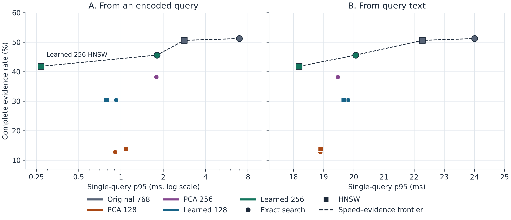

# LRP Learned Projection Retrieval

[繁體中文](README.md) · **English**

**Independent experiment report by Yun-Yao(Paul) Lin** · [繁體中文版](paper/PAPER.zh-TW.md) · [English version](paper/PAPER.en.md)

This project trains a single projection with query–passage relevance labels to compress frozen 768-dimensional Contriever embeddings to 128 or 256 dimensions. I measure how much answer evidence the learned projection recovers and how fast it can retrieve passages. Principal component analysis (PCA) at the same width measures the benefit of training, and original 768-dimensional search provides the reference for evidence lost through compression. I test exact search and Hierarchical Navigable Small World (HNSW) graph search.

## Main findings

| Experiment | Finding |
| --- | --- |
| **Passage ranking on TREC** | On 97 queries and 300,000 passages, learned 128-dimensional exact search scored **0.5182** in nDCG@10 versus **0.3268** for PCA at the same dimension. The paired difference was **+0.1914 [0.1501, 0.2331]**. |
| **Complete evidence on HotpotQA** | With 500 questions and 100,000 passages, 256-dimensional learned and PCA exact search supplied complete evidence for **228 (45.6%)** and **191 (38.2%)** questions. The paired difference was **+7.4 points [4.0, 10.6]**. |
| **HotpotQA retrieval latency** | Learned 256 HNSW was fastest. Relative to original 768 exact search, it reduced p95 by a factor of **25.76** for encoded queries and **1.32** from query text to passage IDs. Complete evidence fell from **51.2% to 41.8%**, a loss of **9.4 percentage points**. Original 768 HNSW was the only alternative to pass the evidence criterion. |

Positions farther left are faster. Positions higher up find complete evidence for more questions. The dashed line connects the best observed trade-offs. Both panels stop timing when the passage IDs are returned.

## Reproduction

Use Python 3.12 from the project root. Install dependencies with `uv venv --python 3.12` and `uv pip install -r requirements.txt`. The code blocks in the linked sections give the complete commands, pinned model snapshots, and data filenames.

1. Download MS MARCO Passage Ranking v1, the TREC 2019–2020 judgments and queries, and the HotpotQA development data and Wikipedia introductions. Prepare the fixed query sets and nested corpora. [Datasets and preparation](EXPERIMENTS.md#如何重跑)
2. Run the baseline, train the shared projection, and lock graph search depth on the MS MARCO development sets. [Projection training and calibration](EXPERIMENTS.md#4-重跑投影訓練開發集評估與設定選擇)
3. Build the TREC indexes, measure the locked settings, and generate the paired analysis. [TREC commands](EXPERIMENTS.md#5-重跑第三階段-trec-正式測試)
4. Retrieve the HotpotQA contexts and score the answers, including the exploratory 256-dimensional learned projection and the same-width PCA exact baseline. Then benchmark all nine methods together. [HotpotQA commands](EXPERIMENTS.md#6-重跑第四階段-hotpotqa-證據與答案評估)

Experiment outputs are written under `artifacts/`. To regenerate both sets of figures from a rerun, pass the three report directories as shown in the figure instructions. With the original report directories, run `.venv/bin/python paper/make_figures.py` with no arguments. Use `--zh-font` to specify a Traditional Chinese font file if needed. [Figure commands](EXPERIMENTS.md#7-重繪報告圖表) · [Figure source](paper/make_figures.py)

[Research protocol (繁體中文)](RESEARCH_PROPOSAL.md) · [Detailed HotpotQA results and examples (繁體中文)](HOTPOTQA_RESULTS.md)
