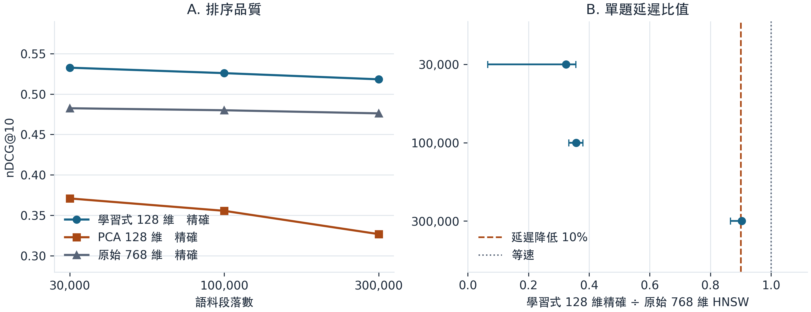
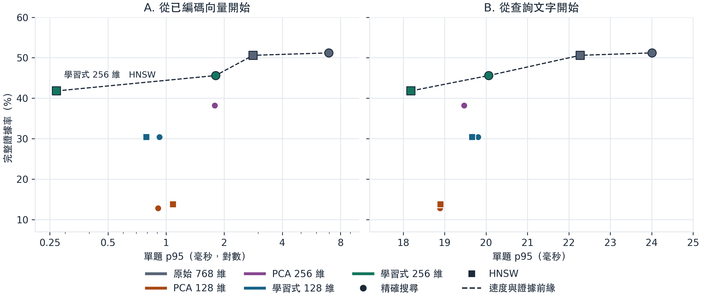

# Learned Projection for RAG Retrieval: Comparing Exact Search and HNSW in Compressed Embedding Spaces

個人獨立實驗報告 · Yun-Yao(Paul) Lin

[繁體中文報告全文](paper/PAPER.zh-TW.md) · [English report](paper/PAPER.en.md) · [English summary](README.en.md)

## 摘要

本實驗的核心問題是，在相同維度與搜尋方式下，用相關性標註訓練的投影能否比主成分分析（PCA）排得更準，並找齊更多題的答題證據。我固定 Contriever 編碼器，訓練線性投影將 768 維向量壓縮到 128 或 256 維。另以原始 768 維向量為基準，量測學習式投影搭配精確搜尋或 HNSW 圖搜尋時的速度與證據代價。

## 報告大綱

1. **緒論** 說明多跳問答為什麼需要找齊支持證據，以及向量壓縮可能帶來的取捨。
2. **研究方法** 以 MS MARCO 訓練投影，用 TREC 評估段落排序與檢索延遲，並用 HotpotQA 評估完整證據率和答案品質。
3. **研究結果** 在 TREC 的 30 萬段測試中，128 維學習式精確搜尋的 nDCG@10 為 **0.5182**，同維度 PCA 為 **0.3268**。在 HotpotQA 的 500 題追加比較中，256 維學習式精確搜尋找齊 **228 題（45.6%）**，比同維度 PCA 多 **37 題**。
4. **討論與限制** 分析語料規模、查詢編碼成本與生成模型設定如何影響結果。256 維的追加結果仍待新題目驗證。

## 主要結果圖表

### TREC 段落排序與檢索延遲

左圖比較三種向量表示的精確搜尋排序品質。右圖比較 128 維學習式精確搜尋與原始 768 維 HNSW 的延遲，比值低於 1 代表學習式精確搜尋較快。

### HotpotQA 完整證據率與檢索延遲

每個點代表一種檢索設定。越靠左越快，越靠上表示找齊證據的題目越多。兩張圖都計時到回傳段落 ID，右圖另計入查詢編碼時間。

## 結論

學習式投影在同維度下比 PCA 找回更多證據。HotpotQA 的 500 題測試中，256 維學習式 HNSW 的單題檢索延遲最低。相較於原始 768 維精確搜尋，完整證據率從 **51.2% 降至 41.8%**，少 **9.4 個百分點（47 題）**。按五輪量測配對估計，從已編碼的查詢向量開始計時，單題 p95 加速 **25.76 倍**。從查詢文字到回傳段落 ID，含編碼的單題 p95 加速 **1.32 倍**。

[研究計畫](RESEARCH_PROPOSAL.md) · [HotpotQA 詳細結果](HOTPOTQA_RESULTS.md) · [實驗結果與重現步驟](EXPERIMENTS.md)

## 授權

本專案的原創程式碼、文件與圖表採用 [MIT 授權](LICENSE)。第三方資料集、模型及套件各自適用其原有授權與使用條款。
