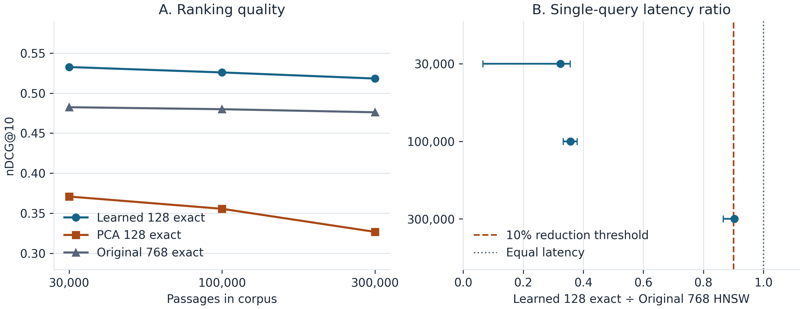
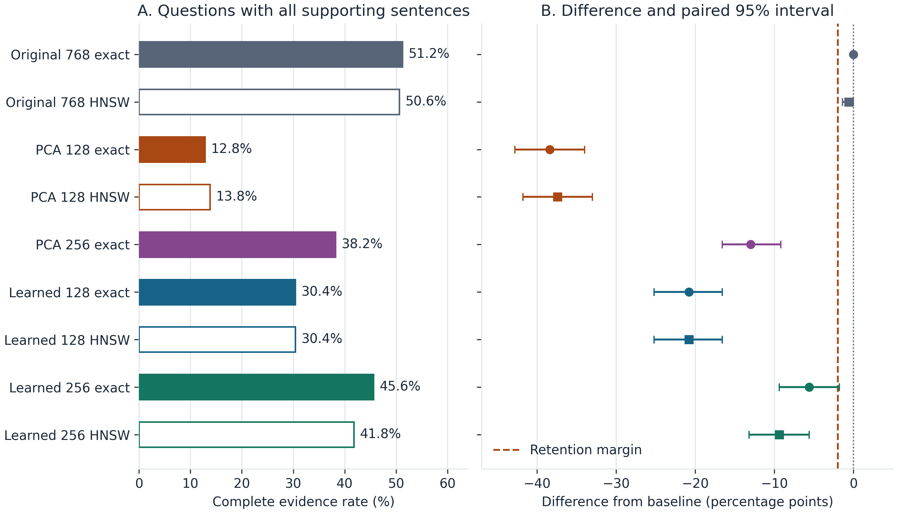
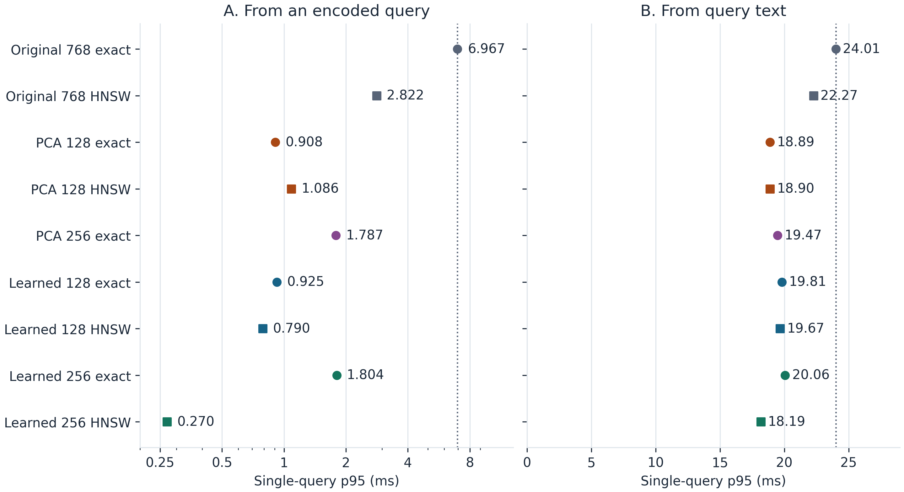
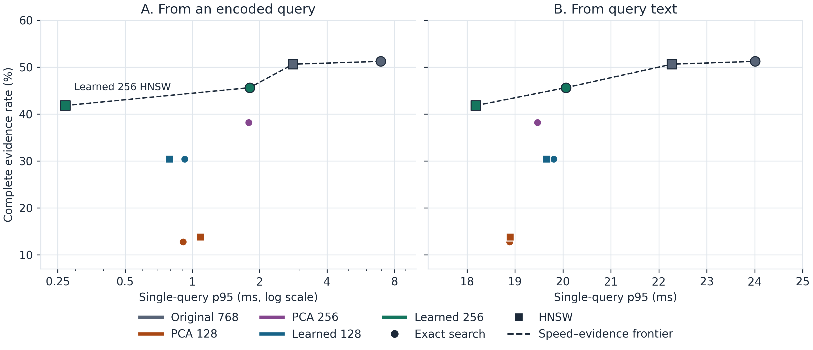

# Learned Projection for Retrieval-Augmented Generation

**Learning from relevance labels to preserve ranking quality and evidence under compression**

Independent experiment report · **Yun-Yao(Paul) Lin**

[繁體中文](PAPER.zh-TW.md) · **English** · [Project README](../README.en.md)

## Abstract

I trained a single linear projection with query–passage relevance labels to compress a frozen Contriever encoder's 768-dimensional embeddings to 128 or 256 dimensions. Principal component analysis (PCA) at the same width measured the benefit of learning, and original 768-dimensional exact search provided the reference for evidence lost through compression. On 97 Text Retrieval Conference Deep Learning Track queries with 300,000 passages, learned 128-dimensional exact search improved top-ten normalized discounted cumulative gain over PCA by 0.1914 (paired 95% interval [0.1501, 0.2331]). On HotpotQA, with 500 questions and 100,000 passages, the learned 128-dimensional projection supplied every annotated supporting sentence for 152 questions, compared with 64 for PCA. At 256 dimensions, an exploratory exact-search comparison found complete evidence for 228 questions with the learned projection, 37 more than PCA. The learned 256-dimensional graph index had the lowest single-query latency. Compared with original exact search, its 95th-percentile latency was lower by a factor of 25.76 for encoded queries and 1.32 from text to passage identifiers. Learning improved retrieval at a fixed width, while the tested 128- and 256-dimensional learned settings fell short of the prespecified criterion for retaining complete evidence relative to original exact search.

**Keywords**  Dense retrieval, embedding compression, multi-hop question answering, evidence coverage, latency

## 1. Introduction

Retrieval-augmented generation (RAG) gives a language model passages to use when answering a question. A multi-hop question such as “What city was the band behind this album founded in?” illustrates the retrieval challenge. One page identifies the band and another links it to the city. Finding the album page can count as a retrieval success while leaving the answer unsupported. HotpotQA makes that distinction measurable through sentence-level evidence annotations. [Lewis et al. (2020)](https://proceedings.neurips.cc/paper/2020/hash/6b493230-Abstract.html) · [Yang et al. (2018)](https://doi.org/10.18653/v1/D18-1259)

I freeze Contriever and train a single linear projection shared by queries and passages. Relevance labels guide the projection toward directions that help match questions to relevant passages. Principal component analysis (PCA) selects directions by variance and supplies both the initial weights and the comparison at the same width. Ma et al. (2021) found that PCA beat their 128-dimensional supervised projection on top-20 answer-span retrieval with a frozen Dense Passage Retrieval encoder. That result motivates testing the benefit of relevance training directly. I also measure whether every annotated supporting sentence reaches the generator. [Ma et al. (2021)](https://doi.org/10.18653/v1/2021.emnlp-main.227)

**RQ1. At the same vector width and with the same search algorithm, can a projection trained on relevance labels improve passage ranking over PCA and retrieve complete evidence for more questions?**

I use 128-dimensional exact search as the primary comparison, measuring passage ranking on TREC and complete evidence on HotpotQA. I also run an exploratory comparison at 256 dimensions. The timing experiments vary corpus size and search algorithm, with retrieval over the original 768-dimensional vectors as a reference for the speed gains and evidence lost through compression. [Study protocol](../RESEARCH_PROPOSAL.md)

## 2. Methods

### 2.1 Representations and search

I froze Contriever, used attention-masked mean pooling, and capped encoder input at 128 tokens. The encoder produces a 768-dimensional vector, which I normalize to unit length. For the compressed variants, I center the unit vector using a training mean, multiply it by a projection matrix, and normalize again. Thus, the inner product used for all search conditions is cosine similarity. PCA was fitted on 2,048 training query vectors and 2,048 training passage vectors. The learned projection starts from the same PCA matrix and updates only the weights of that shared, bias-free layer. The 128- and 256-dimensional versions have 98,304 and 196,608 trainable weights. [Izacard et al. (2022)](https://openreview.net/pdf?id=jKN1pXi7b0) · [Training implementation](../lrp/projection.py) · [Training and model settings](../EXPERIMENTS.md#4-重跑投影訓練開發集評估與設定選擇)

I trained with 8,190 queries from MS MARCO Passage Ranking v1 after filtering the sampled queries for usable negatives. Each batch contained 128 queries. The model increased the cosine score of a labeled positive against other passages in the batch and up to four text-matched negatives per query selected by BM25. Other known positives were masked. I used Adam and cross-entropy on similarity scores divided by a temperature. Selection on 500 MS MARCO development queries with 30,000 passages chose epoch 5, a learning rate of 0.001, and a temperature of 0.07. [MS MARCO Passage Ranking data](https://microsoft.github.io/msmarco/Datasets.html) · [Training implementation](../lrp/projection.py)

Exact search scores every passage. Hierarchical Navigable Small World (HNSW) search follows links between nearby vectors to visit a subset of candidates. I used Faiss with graph degree setting M = 32 and construction depth efConstruction = 200. [Malkov & Yashunin (2020)](https://doi.org/10.1109/TPAMI.2018.2889473)

To compare latency at similar retrieval quality, I prespecified a maximum absolute loss of 0.01 in both normalized discounted cumulative gain at ten (nDCG@10) and Recall@10 relative to original 768-dimensional exact search on a corpus of the same size. For top-ten retrieval, I selected the search depth (efSearch) with the lowest 95th percentile of single-query latency (p95) among settings that met both criteria on the development set. If no depth met both criteria, I chose the highest nDCG@10 and broke ties by latency. A comparable margin appears in the PULSAR document image resolution experiment, which used ±0.01 nDCG@10 as its practical equivalence range. [Development selection](../EXPERIMENTS.md#正式測試採用哪些搜尋設定) · [Constable et al. (2026), §5.1](https://aclanthology.org/2026.emnlp-industry.39v2.pdf)

### 2.2 Benchmarks and decision rules

**Ranked retrieval.** The Text Retrieval Conference (TREC) Deep Learning Track evaluation used 43 judged queries from 2019 and 54 from 2020. Each nested corpus of 30,000, 100,000, or 300,000 passages retained all 20,349 judged passages and added background passages in a fixed order. I scored the rankings using graded relevance and computed binary recall using grades 2 and 3 as relevant. nDCG@10 rewards putting highly relevant passages near the top. Recall@10 measures how many of a query's known relevant passages appear in the top ten. The primary learned-versus-PCA comparison used 128 dimensions, exact search, and 300,000 passages. [TREC 2019 passage judgments](https://trec.nist.gov/data/deep2019.html) · [TREC 2020 passage judgments](https://trec.nist.gov/data/deep2020.html)

For the TREC latency comparison, both candidates had to pass the quality criterion against exact 768-dimensional search. The lower bounds of both paired quality intervals had to be at least −0.01. A practical speed advantage required at least a 10% reduction in single-query p95, with an upper interval bound for the candidate-to-reference p95 ratio of 0.90 or less. For graph search, I also looked for development points within ±5% of original-vector HNSW latency. [Study protocol](../RESEARCH_PROPOSAL.md)

**Multi-hop question answering.** I selected 500 of the 7,405 HotpotQA fullwiki development questions with seed 42. All 1,217 annotated supporting sentences mapped to 995 Wikipedia introduction pages. The corpus combined these 995 pages with 99,005 sampled background pages. Each retriever returned ten pages. The prompt included page titles and text in rank order within a 2,048-token context budget, with question and instructions counted separately. All conditions used Qwen2.5-0.5B-Instruct with the same short-answer prompt, greedy decoding, and at most 32 new tokens. Controls supplied either the question alone or the question plus the annotated sentences. The 256-dimensional evaluation was added after the 128-dimensional HotpotQA results were seen. The projection weights came from MS MARCO training, and efSearch = 32 was selected on the 100,000-passage MS MARCO development corpus. I also ran exact search with 256-dimensional PCA on the same HotpotQA questions to compare the two projection methods at the same width. PCA used all 256 components previously fitted on MS MARCO training data. The original, PCA, and learned 128-dimensional HNSW depths were 512, 512, and 256. [Wikipedia source data](https://hotpotqa.github.io/wiki-readme.html) · [Pinned generator](https://huggingface.co/Qwen/Qwen2.5-0.5B-Instruct/tree/7ae557604adf67be50417f59c2c2f167def9a775) · [Evaluation protocol](../HOTPOTQA_RESULTS.md)

A question counted as having **complete evidence** if every annotated supporting sentence was fully visible in the final prompt. The criterion allowed a loss of two percentage points against exact 768-dimensional search. A method passed when the lower bound of its paired 95% interval reached −2.0 points. Supporting-sentence recall measures the visible fraction of annotated sentences for each question and averages those fractions. I scored answers with HotpotQA's normalized exact match (EM) and token F1, which measures token overlap with the reference answer. I also report METEOR, which considers word matches, stems, and synonyms, using one English reference and the Natural Language Toolkit (NLTK) 3.9.2 implementation. [Official HotpotQA scorer](https://github.com/hotpotqa/hotpot/blob/3635853403a8735609ee997664e1528f4480762a/hotpot_evaluate_v1.py) · [NLTK documentation](https://www.nltk.org/api/nltk.translate.meteor_score.html)

**Uncertainty and timing.** Quality differences use 10,000 paired bootstrap resamples of questions, stratified by year for pooled TREC comparisons. Timing used warmed, single-threaded central processing unit (CPU) search on an Apple M3 with 24 GiB of memory. The encoded-query measurement includes normalization, projection when used, search, and passage ID lookup. The text-to-IDs measurement also includes live query encoding on Metal. HotpotQA used all 500 queries for the encoded measurement and a fixed subset of 100 for text-to-IDs. After adding PCA 256 exact, I rebenchmarked all nine methods in the same five rounds, rotating method order. Latency summaries are medians of the round-level p95 values. Ratio intervals resample the five rounds in pairs and describe variability on this host. Both timing endpoints stop at passage IDs, before answer generation. [Timing protocol](../HOTPOTQA_RESULTS.md#相同問答語料下的速度與品質取捨)

## 3. Results

### 3.1 Passage ranking and search speed on TREC

At 300,000 passages, 128-dimensional learned exact search increased nDCG@10 from 0.3268 to 0.5182 and Recall@10 from 0.1182 to 0.2403 compared with PCA. The paired nDCG@10 improvement was +0.1914 [0.1501, 0.2331]. The interval stayed above zero in 2019 (+0.1732 [0.1127, 0.2371]) and 2020 (+0.2058 [0.1497, 0.2625]). The left panel of Figure 1 shows the ranking scores at all three sizes.

**Table 1. Single-query p95 of two TREC methods that passed the shared test-set quality criterion**

| Passages | Learned 128 exact (ms) | Original 768 HNSW (ms) | Ratio [paired 95% interval] | At least 10% lower p95 supported |
| ---: | ---: | ---: | ---: | :---: |
| 30,000 | 0.272 | 0.841 | 0.323 [0.065, 0.356] | Yes |
| 100,000 | 0.899 | 2.515 | 0.357 [0.333, 0.379] | Yes |
| 300,000 | 2.673 | 2.959 | 0.903 [0.866, 0.909] | No |

**Figure 1. Ranking quality and retrieval latency on 97 TREC queries.** Panel A compares exact search across the three corpus sizes. Panel B shows p95 ratios for learned exact search relative to original HNSW, with paired 95% intervals. A ratio below one favors learned exact search. The practical criterion requires the full interval to lie at or below 0.90.

The learned exact method had a 0.286 ms lower median p95 at 300,000 passages. The upper ratio bound of 0.909 exceeded the 0.90 criterion. Across the measured sizes, neither a practical speed advantage for original HNSW nor a crossover was established. At 300,000 passages, the two serialized indexes occupied 153.6 MB (learned exact) and 1,003.2 MB (original HNSW). Their measured build times were 0.020 s and 275.8 s, starting from vectors already prepared for each index.

For the comparison between graph indexes at 300,000 passages, learned 128-dimensional HNSW achieved 0.236 ms and 0.5179 nDCG@10, versus 2.959 ms and 0.4764 for original HNSW. The paired nDCG@10 difference was +0.0416 [0.0129, 0.0711], and the Recall@10 difference was +0.0170 [−0.0072, 0.0428]. Each method used its own development-selected depth (64 and 512, respectively). The ±5% latency-matched development search found no eligible compressed HNSW point at any measured size, so the locked-point results support a speed–ranking trade-off at different depths.

On the 300,000-passage MS MARCO development corpus, exact-search nDCG@10 was 0.5663 for learned 128, 0.2949 for PCA 128, and 0.5797 for original vectors. On the 30,000-passage development corpus, the learned method also scored above PCA at 64 and 256 dimensions. Changing the initialization or dropping BM25 negatives produced smaller differences, with paired intervals that included zero. [Development and ablation results](../EXPERIMENTS.md#ms-marco-開發集30-萬段)

### 3.2 Complete evidence and answers on HotpotQA

Table 2 uses exact-search comparisons at a fixed width to measure how much additional evidence the trained projection retrieves. Original 768-dimensional exact search provides the reference for evidence coverage before compression.

**Table 2. Evidence coverage and answer quality on 500 HotpotQA questions**

| Method | Support sentence recall | Complete questions | Complete evidence | EM | Token F1 | METEOR |
| --- | ---: | ---: | ---: | ---: | ---: | ---: |
| Original 768 exact | 73.30% | 256 | 51.2% | 0.2320 | 0.3294 | 0.2731 |
| Original 768 HNSW | 72.60% | 253 | 50.6% | 0.2360 | 0.3321 | 0.2748 |
| PCA 128 exact | 32.56% | 64 | 12.8% | 0.1480 | 0.2147 | 0.1761 |
| PCA 128 HNSW | 32.77% | 69 | 13.8% | 0.1500 | 0.2230 | 0.1797 |
| PCA 256 exact (exploratory) | 63.19% | 191 | 38.2% | 0.2440 | 0.3247 | 0.2696 |
| Learned 128 exact | 55.69% | 152 | 30.4% | 0.1980 | 0.2699 | 0.2272 |
| Learned 128 HNSW | 55.59% | 152 | 30.4% | 0.1980 | 0.2697 | 0.2271 |
| Learned 256 exact (exploratory) | 69.53% | 228 | 45.6% | 0.2540 | 0.3427 | 0.2928 |
| Learned 256 HNSW (exploratory) | 64.28% | 209 | 41.8% | 0.2660 | 0.3444 | 0.2904 |
| Question only | 0% | 0 | 0% | 0.0860 | 0.1486 | 0.1164 |
| Question and annotated sentences | 100% | 500 | 100% | 0.4500 | 0.6001 | 0.4706 |

At 128 dimensions with exact search, the learned projection gained 17.6 percentage points in complete evidence over PCA [14.0, 21.4] and lost 20.8 points against original exact search [−25.2, −16.6]. At 256 dimensions, exact search gained 15.2 points [11.8, 18.6] over the learned 128-dimensional method. In paired counts, 82 questions gained complete evidence and six lost it. The 256-dimensional method still had a −5.6 point difference [−9.4, −1.8] against original exact search. As Figure 2 shows, only original HNSW passed the retention criterion among the alternatives, with −0.6 points [−1.4, 0.0].

With exact search at the same width of 256 dimensions, the learned projection supplied complete evidence for 228 questions (45.6%) and PCA for 191 (38.2%). The paired difference was **+7.4 percentage points [4.0, 10.6]**. The learned method alone found complete evidence for 55 questions, and PCA alone for 18. The paired answer F1 difference was +0.0180 [−0.0116, 0.0481].

**Figure 2. Complete evidence and the prespecified retention margin.** The left panel shows the fraction of questions with every annotated supporting sentence visible. The right panel shows paired differences from original 768-dimensional exact search. A method passes if its interval's lower end is at or to the right of the −2.0 percentage-point line. All three 256-dimensional settings are exploratory.

The 256-dimensional HNSW answer F1 was 0.3444 versus 0.3294 for original exact search. The paired difference was +0.0150 [−0.0157, 0.0462]. EM rose by +0.0340 [0.0020, 0.0680] in this exploratory comparison, and the intervals are unadjusted for multiple comparisons. There was no prespecified equivalence margin for answer metrics. Under original exact search, 168 questions had complete evidence and still scored zero on EM, while 28 matched the reference with incomplete annotated evidence. The annotated-evidence control reached 0.4500 EM. These patterns motivate reporting evidence access and answer matching as distinct outcomes. [Per-question error cases](../HOTPOTQA_RESULTS.md#個案複核)

In the album example, original exact search found both pages, and the generator answered “Indianapolis.” The learned 128-dimensional exact method missed the band page, and the generator answered “Forevermore,” the band's name. The learned 256-dimensional exact method recovered both pages, and the generator answered “Indianapolis, Indiana.” The additional state name made that answer score zero on EM. [HotpotQA case 5a8f0a01554299458435d539](../HOTPOTQA_RESULTS.md#個案複核)

### 3.3 HotpotQA latency and throughput

**Table 3. Retrieval timing on the 100,000-passage HotpotQA corpus**

| Method | Encoded-query p95 (ms) | Text-to-IDs p95 (ms) | Batch-32 queries/s |
| --- | ---: | ---: | ---: |
| Original 768 exact | 6.967 | 24.01 | 2,998 |
| Original 768 HNSW | 2.822 | 22.27 | 402 |
| PCA 128 exact | 0.908 | 18.89 | 9,657 |
| PCA 128 HNSW | 1.086 | 18.90 | 1,354 |
| PCA 256 exact (exploratory) | 1.787 | 19.47 | 6,799 |
| Learned 128 exact | 0.925 | 19.81 | 9,738 |
| Learned 128 HNSW | 0.790 | 19.67 | 1,418 |
| Learned 256 exact (exploratory) | 1.804 | 20.06 | 6,766 |
| Learned 256 HNSW (exploratory) | 0.270 | 18.19 | 4,936 |

**Figure 3. Two timing boundaries for the same nine HotpotQA methods.** Circles mark exact search and squares mark HNSW. The dotted line marks original exact search. The left axis is logarithmic. The right axis is linear and includes query encoding.

Figure 4 compares latency and complete evidence directly. At the same width, PCA and learned 256-dimensional exact search had encoded-query p95 values of 1.787 and 1.804 ms, with complete evidence rates of 38.2% and 45.6%. Learned 256 HNSW had the lowest measured single-query p95 at 0.270 ms from encoded queries and 18.19 ms from query text, with a complete evidence rate of 41.8%. It was 25.76 [25.40, 26.12] times as fast as original exact search from encoded queries and 1.32 [1.16, 1.53] times as fast from text, while supplying complete evidence for 47 fewer questions. Batch-32 throughput favored learned 256 exact search over learned 256 HNSW (6,766 vs. 4,936 queries/s).

**Figure 4. Complete evidence versus single-query latency.** Farther left is faster, and higher means more questions with complete evidence. The dashed line connects the trade-off frontier. At each frontier point, improving one metric requires giving up performance on the other among the nine measured settings. The frontier uses point estimates.

Original 768 HNSW was the only alternative to pass the predefined retention criterion. Its complete evidence rate was 50.6% versus 51.2% for original exact search, a difference of three questions. Its encoded-query p95 was 2.822 ms, a 2.47 [2.41, 2.49]-fold speedup. [Full timing report](../HOTPOTQA_RESULTS.md#相同問答語料下的速度與品質取捨)

## 4. Discussion and limitations

Relevance supervision improved fixed-width retrieval over PCA on two tasks, but the tasks tested different requirements. A graded top-ten ranking can improve when relevant passages move upward. Complete-evidence coverage still drops to zero for a question when any one supporting sentence is missing. In this HotpotQA corpus, all annotated sentences missing from retrieved prompts were on pages outside the top ten. The tested introduction passages fit the context budget, so these results give little evidence about truncation in long-document settings.

The 300,000-passage TREC comparison and the 100,000-passage HotpotQA comparison answer different questions about retrieval. The judged-passage share in TREC fell from 67.83% to 6.783% as backgrounds were added. HotpotQA deliberately retained all mapped support pages. This makes within-corpus comparisons possible while limiting extrapolation to unrestricted corpora with different distractors. The full MS MARCO collection contained 8,841,823 passages. Its original 768-dimensional float32 vectors alone would occupy 25.30 GiB, more than the test host's memory. Full-corpus behavior, a latency crossover beyond the measured sizes, and performance across hardware remain open.

Answer scores depend on one generator, prompt, and output cap. Some zero-EM answers were valid name variants, and at least one annotated-evidence example ran out of output tokens. A correct short answer with incomplete evidence does not demonstrate grounding in the retrieved text. The 256-dimensional results were added after examining the 128-dimensional results and should be confirmed on fresh questions. The development ablations used the same queries for model selection and comparison, so their intervals do not establish general effects of PCA initialization or BM25 negatives. [Ablation results](../EXPERIMENTS.md#哪些訓練選擇有影響3-萬段開發集) · [Error examples](../HOTPOTQA_RESULTS.md#個案複核)

## 5. Conclusion

**The experiments support RQ1. In exact search at the same width, the learned projection ranked passages better and retrieved complete evidence more often than PCA.** At 128 dimensions and 300,000 TREC passages, nDCG@10 increased from 0.3268 to 0.5182. The number of HotpotQA questions with complete evidence increased from 64 to 152. In the exploratory 256-dimensional comparison, the learned projection supplied complete evidence for 37 more questions than PCA at similar encoded-query latencies. The rate rose from 38.2% to 45.6%, a paired difference of +7.4 percentage points [4.0, 10.6].

At 30,000 and 100,000 TREC passages, learned 128-dimensional exact search met the shared quality criterion, and the results supported at least a 10% reduction in single-query p95 relative to original 768-dimensional HNSW.

On 500 HotpotQA questions, original 768-dimensional exact search supplied complete evidence for **51.2%** of questions. Its single-query p95 was **6.967 ms** from an encoded query and **24.01 ms** from query text. The table compares both learned 256-dimensional settings against this baseline.

| Learned 256-dimensional setting | Complete evidence rate (vs. baseline) | Encoded-query p95 | Query-text p95 |
| --- | ---: | ---: | ---: |
| Exact search | 45.6% (5.6 percentage points lower, 28 fewer questions) | 1.804 ms (3.86× speedup) | 20.06 ms (1.20× speedup) |
| HNSW | 41.8% (9.4 percentage points lower, 47 fewer questions) | 0.270 ms (25.76× speedup) | 18.19 ms (1.32× speedup) |

Both settings fell short of the prespecified complete-evidence retention criterion. [Complete evidence versus latency](figures/hotpot-evidence-latency.en.png)

The exploratory 256-dimensional comparisons used the same HotpotQA questions and remain to be confirmed on fresh questions. Retrieval timing ends when passage IDs are returned.

**In plain language.** The study asks whether a small projection layer can learn to shorten vectors and still find more of the clues needed to answer a question. At the same 256 dimensions, the trained projection found all the clues for 37 more questions than PCA. Pairing that projection with HNSW graph search gave the fastest retrieval in the test. The remaining challenge is to keep that speed while recovering the clues the compressed search still misses.

## Reproducibility and notes

- **Data and code.** The benchmarks and source models are public. The repository contains preparation, retrieval, scoring, and timing code and documents the pinned inputs. Experiment outputs are generated locally under `artifacts/`. Figure 1 reads `phase3-report/analysis.json` and `operating-points.csv`. Figures 2–4 read `phase4-report-pca256/summary.json` and `phase4-timing-pca256/timing.json`. [Reproduction steps](../README.en.md#reproduction) · [Figure script](make_figures.py)
- **AI assistance.** Codex helped prepare the two language versions of this report and plot the results. Qwen2.5-0.5B-Instruct generated answers in the experiment.

## References

- Constable, B., Roy, A., Sharma, V., Upadhyay, R., Mills, R., & Millar, A. (2026). PULSAR: Pooled unified late-interaction search and retrieval for enterprise visual document RAG. *Proceedings of EMNLP 2026, Industry Track*, 655–666. [DOI 10.18653/2026.emnlp-industry.39](https://doi.org/10.18653/2026.emnlp-industry.39)
- Izacard, G., Caron, M., Hosseini, L., Riedel, S., Bojanowski, P., Joulin, A., & Grave, E. (2022). Unsupervised dense information retrieval with contrastive learning. *Transactions on Machine Learning Research*. [OpenReview](https://openreview.net/pdf?id=jKN1pXi7b0)
- Lewis, P., Perez, E., Piktus, A., Petroni, F., Karpukhin, V., Goyal, N., Küttler, H., Lewis, M., Yih, W., Rocktäschel, T., Riedel, S., & Kiela, D. (2020). Retrieval-augmented generation for knowledge-intensive NLP tasks. *Advances in Neural Information Processing Systems, 33*, 9459–9474. [NeurIPS proceedings](https://proceedings.neurips.cc/paper/2020/hash/6b493230-Abstract.html)
- Ma, X., Li, M., Sun, K., Xin, J., & Lin, J. (2021). Simple and effective unsupervised redundancy elimination to compress dense vectors for passage retrieval. *Proceedings of EMNLP 2021*, 2854–2859. [DOI 10.18653/v1/2021.emnlp-main.227](https://doi.org/10.18653/v1/2021.emnlp-main.227)
- Malkov, Y. A., & Yashunin, D. A. (2020). Efficient and robust approximate nearest neighbor search using hierarchical navigable small world graphs. *IEEE Transactions on Pattern Analysis and Machine Intelligence, 42*(4), 824–836. [DOI 10.1109/TPAMI.2018.2889473](https://doi.org/10.1109/TPAMI.2018.2889473)
- Yang, Z., Qi, P., Zhang, S., Bengio, Y., Cohen, W. W., Salakhutdinov, R., & Manning, C. D. (2018). HotpotQA: A dataset for diverse, explainable multi-hop question answering. *Proceedings of EMNLP 2018*, 2369–2380. [DOI 10.18653/v1/D18-1259](https://doi.org/10.18653/v1/D18-1259)
