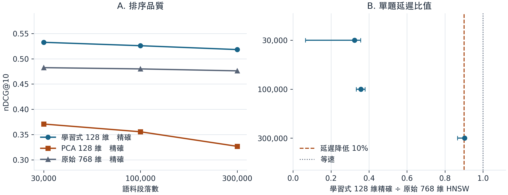
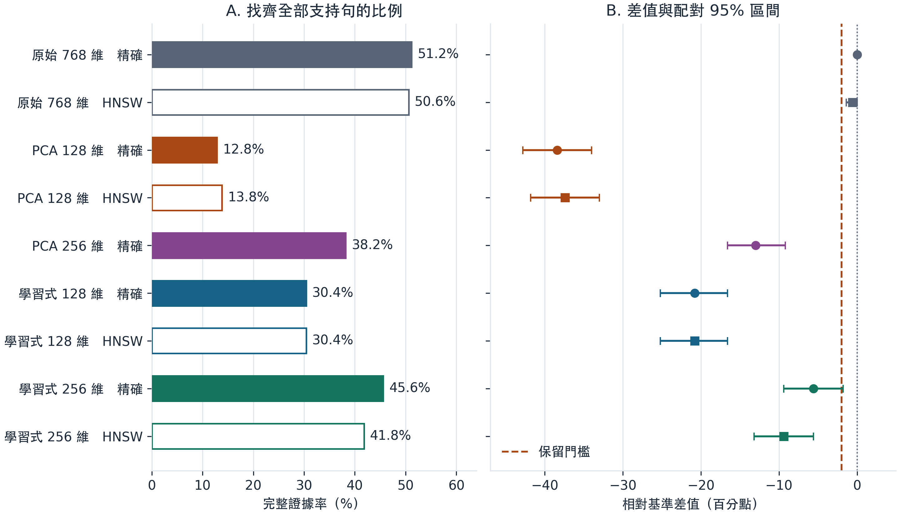
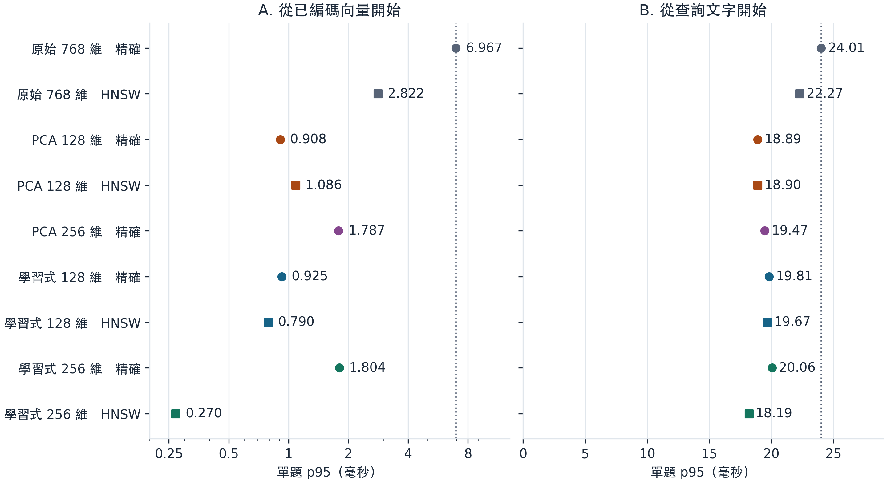
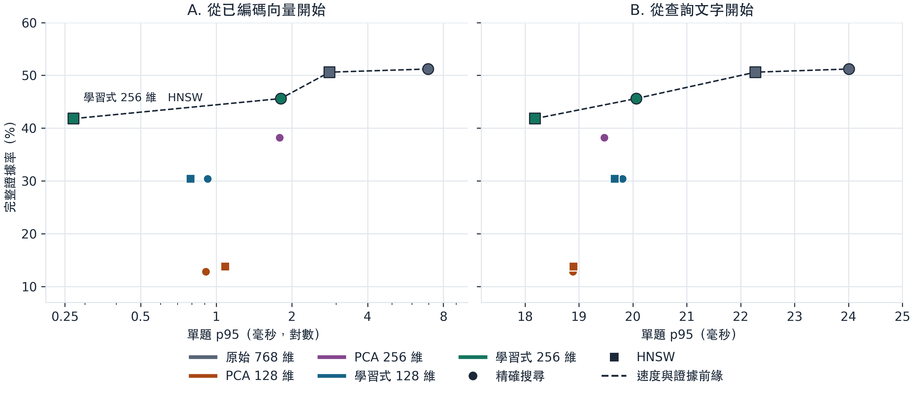

# 檢索增強生成的學習式向量投影

**用相關性標註訓練低維投影，評估排序品質、檢索延遲與完整證據**

個人獨立實驗報告 · **Yun-Yao(Paul) Lin**

**繁體中文** · [English](PAPER.en.md) · [專案 README](../README.md)

## 摘要

本研究以查詢和段落的相關性標註訓練一層線性投影，將固定的 Contriever 編碼器輸出的 768 維向量壓縮到 128 或 256 維。我用同維度的主成分分析（PCA）衡量學習帶來的改善，並以原始 768 維精確搜尋衡量壓縮後的證據損失。在文字檢索會議（TREC）深度學習測試的 97 題與 30 萬段語料中，128 維學習式精確搜尋的前十名正規化折損累積增益比 PCA 高 0.1914，配對 95% 區間為 [0.1501, 0.2331]。在 HotpotQA 的 500 題與 10 萬段語料中，128 維學習式精確搜尋找齊 152 題的所有標註支持句，PCA 找齊 64 題。追加的 256 維精確搜尋中，學習式投影找齊 228 題，較同維度 PCA 多 37 題。學習式 256 維搭配圖搜尋時單題延遲最低，相對原始精確搜尋，已編碼查詢的第 95 百分位延遲加速 25.76 倍，從查詢文字到回傳段落識別碼加速 1.32 倍。實測的學習式投影改善了同維度的檢索表現，128 與 256 維設定仍未達到相對原始精確搜尋所訂的完整證據保留門檻。

**關鍵詞**　稠密檢索、向量壓縮、多跳問答、證據覆蓋、延遲

## 一、緒論

檢索增強生成（Retrieval-Augmented Generation, RAG）先找出相關段落，再把它們交給語言模型回答問題。假設題目問「推出這張專輯的樂團在哪座城市成立？」專輯頁可用來辨認樂團，樂團頁才可能指出城市。只找到專輯頁，檢索仍找回了一個相關段落，但生成模型少了一環。HotpotQA 提供句子層級的支持證據標註，因此可以量測這類缺漏。 [Lewis 等人（2020）](https://proceedings.neurips.cc/paper/2020/hash/6b493230-Abstract.html) · [Yang 等人（2018）](https://doi.org/10.18653/v1/D18-1259)

本研究的做法是固定 Contriever 編碼器，只訓練一層由查詢與段落共用的線性投影。這一層利用「哪個段落與問題相關」的標註，學習壓縮後應保留哪些方向。主成分分析（Principal Component Analysis, PCA）依向量的變異選擇方向，提供投影的起始權重，也提供同維度的對照。Ma 等人（2021）固定 Dense Passage Retrieval 編碼器，發現 128 維 PCA 在前 20 段的答案片段檢索上優於他們的監督式線性投影。這使得學習是否有效成為需要實測的問題。本研究另外量測生成模型能否看到全部標註支持句。 [Ma 等人（2021）](https://doi.org/10.18653/v1/2021.emnlp-main.227)

**RQ1　固定向量維度與搜尋方式時，用相關性標註訓練的投影，能否比 PCA 改善段落排序，並讓更多題目找齊答題證據？**

我以 128 維精確搜尋為主要對照，在 TREC 量測段落排序，在 HotpotQA 量測完整證據率，並追加 256 維的同維度比較。速度實驗另比較不同語料規模與搜尋方式，並以原始 768 維檢索為基準，呈現學習式投影的加速幅度與證據代價。 [研究計畫](../RESEARCH_PROPOSAL.md)

## 二、研究方法

### 2.1 向量表示與搜尋

Contriever 的權重固定不動。編碼輸入最多 128 個 tokens，對有效 token 的表示取平均，產生 768 維向量，再將向量長度調為 1。兩種壓縮方法都先減去訓練向量的平均值，再乘上投影矩陣，最後再次調整長度。搜尋使用內積，此時等同於餘弦相似度。PCA 使用訓練集各 2,048 個查詢與段落向量估計均值及主成分。學習式投影從同一組 PCA 權重開始，只更新查詢與段落共用的無偏置線性矩陣。128 維有 98,304 個可訓練權重，256 維有 196,608 個。 [Izacard 等人（2022）](https://openreview.net/pdf?id=jKN1pXi7b0) · [投影訓練實作](../lrp/projection.py) · [模型與訓練設定](../EXPERIMENTS.md#4-重跑投影訓練開發集評估與設定選擇)

投影用 MS MARCO Passage Ranking v1 的 8,190 個訓練查詢，每批 128 題。正例取自資料集標註。負例來自同批其他段落以及 BM25 選出的最多四段用字相近的段落。其餘已知正例會從負例中遮罩。以 Adam 最佳化器和交叉熵訓練，交叉熵的輸入為除以溫度參數後的相似度分數。在 3 萬段、500 道 MS MARCO 開發題上選出第 5 輪、學習率 0.001、溫度 0.07 的設定。 [MS MARCO 段落排序資料](https://microsoft.github.io/msmarco/Datasets.html) · [投影訓練實作](../lrp/projection.py)

精確搜尋逐一給每段打分。階層式可導航小世界圖（Hierarchical Navigable Small World, HNSW）沿近鄰連結探索部分候選段落。本研究使用 Faiss，建圖設定為 M = 32、efConstruction = 200。 [Malkov 與 Yashunin（2020）](https://doi.org/10.1109/TPAMI.2018.2889473)

為在相近的檢索品質下比較延遲，本研究預先限制前十名正規化折損累積增益（normalized discounted cumulative gain at ten, nDCG@10）及 Recall@10 相對同規模的原始 768 維精確搜尋，兩項指標的絕對降幅各以 0.01 為上限。在開發集取前十段時，我從兩項指標均達標的搜尋深度（efSearch）中，選擇單題第 95 百分位延遲（p95）最低者。若各深度皆未達標，選 nDCG@10 最高者，同分時取延遲較低者。相近的容許範圍見於 PULSAR 的文件影像解析度實驗，該實驗使用 ±0.01 nDCG@10 作為實務等效範圍。 [開發集設定](../EXPERIMENTS.md#正式測試採用哪些搜尋設定) · [Constable 等人（2026），§5.1](https://aclanthology.org/2026.emnlp-industry.39v2.pdf)

### 2.2 評估資料與判準

**段落排序。** 文字檢索會議（Text Retrieval Conference, TREC）深度學習測試使用 2019 年有人工標註的 43 題，以及 2020 年的 54 題。三種規模為 3 萬、10 萬、30 萬段，均保留兩年全部 20,349 段已判定段落，再依固定順序增加背景段落。nDCG@10 獎勵把高相關段落排在前面。Recall@10 衡量該題所有已知相關段落中，有多少比例排進前十名，並依官方段落標註將 2 或 3 分視為相關。主要比較固定為 30 萬段、128 維及精確搜尋。 [TREC 2019 段落標註](https://trec.nist.gov/data/deep2019.html) · [TREC 2020 段落標註](https://trec.nist.gov/data/deep2020.html)

速度比較要求雙方先通過各規模的共同品質門檻。相對原始 768 維精確搜尋，兩個品質指標的配對區間下界都須達 −0.01。單題 p95 比值的區間上界須低於或等於 0.90，才支持至少快 10%。比較圖搜尋時，也另外在開發集找延遲落在原始 HNSW 的 ±5% 內的低維設定。 [研究計畫](../RESEARCH_PROPOSAL.md)

**多跳問答。** 從 HotpotQA fullwiki 開發集的 7,405 題以種子 42 抽出 500 題。1,217 句支持句均可對回 995 個 Wikipedia 導言頁。保留這些頁面，再補 99,005 個背景頁。各方法取前十段，依排名將頁名及正文放進最多 2,048 tokens 的上下文，題目和指令另計。各組都使用 Qwen2.5-0.5B-Instruct、同一短答案提示、貪婪解碼與 32 個新 tokens 的輸出上限。兩個對照分別只給問題，以及提供問題和標註支持句。256 維組是在看到 128 維 HotpotQA 結果後追加，沿用 MS MARCO 訓練權重，並在同規模的 MS MARCO 開發集選定 efSearch = 32。同一批 HotpotQA 題目另補做 PCA 256 維精確搜尋，以固定維度與搜尋方式來比較投影方法。PCA 使用在 MS MARCO 訓練資料上已擬合的全部 256 個主成分。原始、PCA 128 維及學習式 128 維 HNSW 的深度依序為 512、512、256。 [Wikipedia 導言資料](https://hotpotqa.github.io/wiki-readme.html) · [固定生成模型](https://huggingface.co/Qwen/Qwen2.5-0.5B-Instruct/tree/7ae557604adf67be50417f59c2c2f167def9a775) · [問答評估設定](../HOTPOTQA_RESULTS.md)

**完整證據率**是所有標註支持句都完整出現在提示中的題目比例。預設可容許相對原始精確搜尋少 2 個百分點。若各組差值的配對 95% 區間下界達到 −2.0 個百分點，即通過證據保留門檻。支持句召回率先計算每題完整可見的標註句比例，再跨題取平均。答案採 HotpotQA 官方程式計算字串正規化後的精確匹配（exact match, EM）與衡量詞元重疊的 token F1。另以自然語言工具套件（Natural Language Toolkit, NLTK）3.9.2 對單一英文參考答案計算 METEOR，納入字詞、詞幹及同義詞匹配。 [HotpotQA 官方評分程式](https://github.com/hotpotqa/hotpot/blob/3635853403a8735609ee997664e1528f4480762a/hotpot_evaluate_v1.py) · [NLTK 計分定義](https://www.nltk.org/api/nltk.translate.meteor_score.html)

**統計與計時。** 品質差值按查詢配對重抽 10,000 次，合併 TREC 兩年資料時依年度分層。計時使用 Apple M3、24 GiB 記憶體，搜尋索引已暖機並採單執行緒。「已編碼」從查詢向量開始，包含正規化、必要的投影、搜尋和段落 ID 對照。「從文字開始」加計 Metal 即時編碼。HotpotQA 前者使用 500 題，後者使用固定抽取的 100 題。追加 PCA 256 維後，九組在同一批五輪中重測，並輪換方法順序。每組取五輪 p95 的中位數，按輪次配對重抽估計比值區間，以反映同一台主機上的量測變動。兩種計時都在取回段落 ID 時停止，答案生成另計。 [詳細量測方式](../HOTPOTQA_RESULTS.md#相同問答語料下的速度與品質取捨)

## 三、研究結果

### 3.1 TREC 段落排序與搜尋速度

在 30 萬段的主要比較中，128 維學習式精確搜尋的 nDCG@10 為 0.5182，PCA 為 0.3268，差 +0.1914 [0.1501, 0.2331]。Recall@10 由 0.1182 提高為 0.2403。分年比較的 nDCG@10 差值區間也都高於零，2019 年為 +0.1732 [0.1127, 0.2371]，2020 年為 +0.2058 [0.1497, 0.2625]。圖 1 左側顯示三種規模的排序分數。

**表 1　TREC 中兩種通過共同品質門檻的方法的單題 p95**

| 段落數 | 學習式 128 維精確（ms） | 原始 768 維 HNSW（ms） | 比值 [配對 95% 區間] | 支持 p95 至少降低 10% |
| ---: | ---: | ---: | ---: | :---: |
| 30,000 | 0.272 | 0.841 | 0.323 [0.065, 0.356] | 是 |
| 100,000 | 0.899 | 2.515 | 0.357 [0.333, 0.379] | 是 |
| 300,000 | 2.673 | 2.959 | 0.903 [0.866, 0.909] | 否 |

**圖 1　TREC 97 題的排序品質與檢索延遲。** 左側比較三種表示做精確搜尋時的排序。右側以學習式精確搜尋的 p95 除以原始 HNSW 的 p95，並標示配對 95% 區間。比值小於 1 代表學習式精確搜尋較快。實質加速要求整個區間落在 0.90 或以下。

在 30 萬段，學習式精確搜尋的 p95 中位數快 0.286 毫秒，但比值區間上界 0.909 超過 0.90 的判準。三個測點尚未界定原始 HNSW 取得實質速度優勢的規模。同樣在 30 萬段，學習式精確索引與原始 HNSW 索引分別占 153.6 MB 和 1,003.2 MB。從已備妥的向量起算，建置耗時分別為 0.020 秒和 275.8 秒。

兩種圖索引相比，30 萬段的學習式 128 維 HNSW 為 0.236 毫秒、nDCG@10 0.5179，原始 HNSW 為 2.959 毫秒、0.4764。配對的 nDCG@10 差值為 +0.0416 [0.0129, 0.0711]，Recall@10 差值為 +0.0170 [−0.0072, 0.0428]。兩組使用各自在開發集選定的深度 64 與 512。三個規模都找不到與原始 HNSW 延遲相差在 ±5% 內的低維操作點，因此這組結果反映各自選定深度下的速度與排名差異。

在 MS MARCO 的 30 萬段開發語料上，學習式 128 維、PCA 128 維及原始向量的精確搜尋 nDCG@10 分別為 0.5663、0.2949 和 0.5797。3 萬段的開發集比較中，學習式投影在 64 維與 256 維也優於同維度 PCA。更換初始權重或移除 BM25 負例的差距較小，配對區間都包含零。 [開發集與消融結果](../EXPERIMENTS.md#ms-marco-開發集30-萬段)

### 3.2 HotpotQA 完整證據與答案品質

表 2 的同維度精確搜尋比較用來衡量訓練投影層後多找回多少證據。原始 768 維精確搜尋則提供壓縮前的證據覆蓋基準。

**表 2　HotpotQA 500 題的證據覆蓋與答案品質**

| 方法 | 支持句召回率 | 找齊題數 | 完整證據率 | EM | Token F1 | METEOR |
| --- | ---: | ---: | ---: | ---: | ---: | ---: |
| 原始 768 維精確 | 73.30% | 256 | 51.2% | 0.2320 | 0.3294 | 0.2731 |
| 原始 768 維 HNSW | 72.60% | 253 | 50.6% | 0.2360 | 0.3321 | 0.2748 |
| PCA 128 維精確 | 32.56% | 64 | 12.8% | 0.1480 | 0.2147 | 0.1761 |
| PCA 128 維 HNSW | 32.77% | 69 | 13.8% | 0.1500 | 0.2230 | 0.1797 |
| PCA 256 維精確（追加） | 63.19% | 191 | 38.2% | 0.2440 | 0.3247 | 0.2696 |
| 學習式 128 維精確 | 55.69% | 152 | 30.4% | 0.1980 | 0.2699 | 0.2272 |
| 學習式 128 維 HNSW | 55.59% | 152 | 30.4% | 0.1980 | 0.2697 | 0.2271 |
| 學習式 256 維精確（追加） | 69.53% | 228 | 45.6% | 0.2540 | 0.3427 | 0.2928 |
| 學習式 256 維 HNSW（追加） | 64.28% | 209 | 41.8% | 0.2660 | 0.3444 | 0.2904 |
| 僅問題 | 0% | 0 | 0% | 0.0860 | 0.1486 | 0.1164 |
| 問題及標註支持句 | 100% | 500 | 100% | 0.4500 | 0.6001 | 0.4706 |

128 維學習式精確搜尋比同維度 PCA 多 17.6 個百分點 [14.0, 21.4] 的完整證據率，比原始精確搜尋少 20.8 個百分點 [−25.2, −16.6]。精確搜尋從學習式 128 維提高到 256 維後，82 題新取得全部支持句，6 題失去，淨增 76 題，完整證據率提高 15.2 個百分點 [11.8, 18.6]。256 維精確搜尋相對原始精確搜尋的差值為 −5.6 個百分點 [−9.4, −1.8]。如圖 2 所示，只有原始 768 維 HNSW 通過證據保留門檻，差值為 −0.6 個百分點 [−1.4, 0.0]。

在追加的同維度比較中，256 維 PCA 精確搜尋找齊 191 題（38.2%），學習式投影找齊 228 題（45.6%），配對差值為 **+7.4 個百分點 [4.0, 10.6]**。55 題只有學習式投影找齊，18 題只有 PCA 找齊。同一組比較的答案 F1 差值為 +0.0180 [−0.0116, 0.0481]，區間包含零。

**圖 2　完整證據率與預設保留門檻。** 左側為找齊所有標註支持句的題目比例。右側為各組相對原始 768 維精確搜尋的差值及配對 95% 區間。區間左端位於 −2.0 個百分點虛線上或右側即通過。三個 256 維設定均為追加比較。

256 維 HNSW 的答案 F1 為 0.3444，原始精確搜尋為 0.3294，配對差值 +0.0150 [−0.0157, 0.0462]。這組追加比較的 EM 差值為 +0.0340 [0.0020, 0.0680]。這些區間未做多重比較校正，答案指標也沒有預設等效門檻。原始精確搜尋中，168 題證據齊全但 EM 為 0，另有 28 題證據不全但答中參考答案。即使直接提供標註支持句，EM 也只有 0.4500。因此，找到證據和答中參考答案應分開評估。 [逐題錯誤案例](../HOTPOTQA_RESULTS.md#個案複核)

以緒論的專輯問題為例，原始精確搜尋找齊兩頁，模型回答 Indianapolis。學習式 128 維精確搜尋漏掉樂團頁，模型答成樂團名稱 Forevermore。256 維精確搜尋找回兩頁，模型回答 Indianapolis, Indiana。因為多寫了州名，這個答案在 EM 仍記為 0。 [HotpotQA 案例 5a8f0a01554299458435d539](../HOTPOTQA_RESULTS.md#個案複核)

### 3.3 HotpotQA 延遲與吞吐量

**表 3　HotpotQA 10 萬段語料的檢索計時**

| 方法 | 已編碼單題 p95（ms） | 查詢文字至段落 ID p95（ms） | 32 題批次（題／秒） |
| --- | ---: | ---: | ---: |
| 原始 768 維精確 | 6.967 | 24.01 | 2,998 |
| 原始 768 維 HNSW | 2.822 | 22.27 | 402 |
| PCA 128 維精確 | 0.908 | 18.89 | 9,657 |
| PCA 128 維 HNSW | 1.086 | 18.90 | 1,354 |
| PCA 256 維精確（追加） | 1.787 | 19.47 | 6,799 |
| 學習式 128 維精確 | 0.925 | 19.81 | 9,738 |
| 學習式 128 維 HNSW | 0.790 | 19.67 | 1,418 |
| 學習式 256 維精確（追加） | 1.804 | 20.06 | 6,766 |
| 學習式 256 維 HNSW（追加） | 0.270 | 18.19 | 4,936 |

**圖 3　九種方法的兩種計時起點。** 圓點是精確搜尋，方點是 HNSW。點線標出原始精確搜尋。左圖使用對數尺度，右圖含即時編碼，使用線性尺度。

圖 4 把完整證據率和延遲放在一起。256 維 PCA 與同維度學習式精確搜尋的已編碼單題 p95 分別為 1.787 與 1.804 毫秒，完整證據率分別為 38.2% 與 45.6%。學習式 256 維 HNSW 的單題 p95 最低，從已編碼向量和從文字開始分別為 0.270 與 18.19 毫秒，完整證據率為 41.8%。相對原始精確搜尋，兩種計時分別加速 25.76 [25.40, 26.12] 倍和 1.32 [1.16, 1.53] 倍，同時少找齊 47 題。以每批 32 題處理時，256 維學習式精確搜尋的吞吐量較高，每秒 6,766 題，HNSW 為 4,936 題。

**圖 4　完整證據率與單題延遲。** 點越靠左代表越快，越高代表找齊證據的題目越多。虛線連接速度與證據的取捨前緣。對線上任一點，若要讓其中一項更好，就得犧牲另一項。前緣依這九種設定的點估計繪製。

若要通過預設證據保留門檻，原始 768 維 HNSW 是唯一達標的替代設定。其完整證據率為 50.6%，比原始精確搜尋的 51.2% 少 3 題，已編碼 p95 為 2.822 毫秒，相對基準加速 2.47 [2.41, 2.49] 倍。 [完整計時報告](../HOTPOTQA_RESULTS.md#相同問答語料下的速度與品質取捨)

## 四、討論與限制

相關性標註訓練讓學習式投影在同維度下比 PCA 更有效，但兩個任務衡量不同要求。TREC 會因高相關段落排得更前面而加分。HotpotQA 則只要缺一個支持句，就把該題判為證據不完整。本次九組檢索條件漏掉的標註句都來自未排進前十名的頁面。這批短導言在輸入預算內，長文件在截斷後會失去多少證據仍待測量。

TREC 語料保留全部已判定段落。3 萬至 30 萬段的已判定段落占比從 67.83% 降至 6.783%。HotpotQA 也保留所有映射的支持頁。各組可以在相同干擾段落下比較，結果的適用範圍取決於這些固定語料。完整 MS MARCO 庫有 8,841,823 段，只存原始 768 維 float32 向量就需要 25.30 GiB，已超過本機記憶體。全庫表現、速度優勢是否在更大規模互換，以及換硬體後的差距仍有待驗證。

答案品質會受生成模型、提示與長度上限影響。案例中有符合題意的姓名簡寫被 EM 判錯，也有模型即使看到完整證據，仍因輸出太短未列完答案。證據不全時答對，單靠答案分數也無法判定模型用了哪些資料。256 維是在看過 128 維結果後追加，適合在新題目上複核。開發集消融也用了同一批題目選參數與比較，PCA 初始化及加入 BM25 負例的效果仍有不確定性。 [消融結果](../EXPERIMENTS.md#哪些訓練選擇有影響3-萬段開發集) · [錯誤案例](../HOTPOTQA_RESULTS.md#個案複核)

## 五、結論

**RQ1 的答案是，在本實驗的同維度精確搜尋比較中，學習式投影比 PCA 排得更準，也更常找齊答題證據。** 同為 128 維，30 萬段 TREC 的 nDCG@10 從 0.3268 提升至 0.5182，HotpotQA 找齊全部支持句的題數從 64 增至 152。追加的 256 維比較中，學習式投影在相近的已編碼延遲下，比 PCA 多找齊 37 題，完整證據率從 38.2% 提升至 45.6%，配對差值為 +7.4 個百分點 [4.0, 10.6]。

在 TREC 的 3 萬與 10 萬段測試中，128 維學習式精確搜尋通過共同品質門檻，結果支持其單題 p95 比原始 768 維 HNSW 至少降低 10%。

在 HotpotQA 的 500 題中，原始 768 維精確搜尋的完整證據率為 **51.2%**，已編碼單題 p95 為 **6.967 ms**，從查詢文字開始計時則為 **24.01 ms**。下表以這組數值為基準。

| 學習式 256 維設定 | 完整證據率（相對基準） | 已編碼單題 p95 | 從查詢文字開始的單題 p95 |
| --- | ---: | ---: | ---: |
| 精確搜尋 | 45.6%（少 5.6 個百分點，28 題） | 1.804 ms（加速 3.86 倍） | 20.06 ms（加速 1.20 倍） |
| HNSW | 41.8%（少 9.4 個百分點，47 題） | 0.270 ms（加速 25.76 倍） | 18.19 ms（加速 1.32 倍） |

兩種設定均未達預設的完整證據保留門檻。 [完整證據率與延遲圖](figures/hotpot-evidence-latency.zh-TW.png)

256 維的結果來自同一批 HotpotQA 題目的追加比較，仍待新題目複核。圖中的檢索延遲以回傳段落 ID 為終點。

**白話總結。** 這項研究想知道，能不能訓練一個小小的投影層，讓向量變短之後，仍能找回更多答題線索。同樣壓到 256 維，用標註訓練後，投影比 PCA 多找齊 37 題。再把這個投影搭配 HNSW 圖搜尋，就得到這次測試中最快的檢索。接下來要解決的是，怎麼保住速度，同時找回目前還會漏掉的關鍵線索。

## 重現與說明

- **資料與程式。** 本研究使用公開資料集及模型。專案提供資料準備、檢索、計分與計時程式，並記錄資料及模型版本。實驗輸出在本機的 `artifacts/` 產生。圖 1 讀取 `phase3-report/analysis.json` 與 `operating-points.csv`。圖 2 至圖 4 讀取 `phase4-report-pca256/summary.json` 與 `phase4-timing-pca256/timing.json`。 [重現步驟](../EXPERIMENTS.md#如何重跑) · [製圖程式](make_figures.py)
- **AI 使用。** Codex 協助整理中英文實驗報告及繪圖。Qwen2.5-0.5B-Instruct 用於實驗的答案生成。

## 參考文獻

- Constable, B., Roy, A., Sharma, V., Upadhyay, R., Mills, R., & Millar, A. (2026). PULSAR: Pooled unified late-interaction search and retrieval for enterprise visual document RAG. *Proceedings of EMNLP 2026, Industry Track*, 655–666. [DOI 10.18653/2026.emnlp-industry.39](https://doi.org/10.18653/2026.emnlp-industry.39)
- Izacard, G., Caron, M., Hosseini, L., Riedel, S., Bojanowski, P., Joulin, A., & Grave, E. (2022). Unsupervised dense information retrieval with contrastive learning. *Transactions on Machine Learning Research*. [OpenReview](https://openreview.net/pdf?id=jKN1pXi7b0)
- Lewis, P., Perez, E., Piktus, A., Petroni, F., Karpukhin, V., Goyal, N., Küttler, H., Lewis, M., Yih, W., Rocktäschel, T., Riedel, S., & Kiela, D. (2020). Retrieval-augmented generation for knowledge-intensive NLP tasks. *Advances in Neural Information Processing Systems, 33*, 9459–9474. [NeurIPS proceedings](https://proceedings.neurips.cc/paper/2020/hash/6b493230-Abstract.html)
- Ma, X., Li, M., Sun, K., Xin, J., & Lin, J. (2021). Simple and effective unsupervised redundancy elimination to compress dense vectors for passage retrieval. *Proceedings of EMNLP 2021*, 2854–2859. [DOI 10.18653/v1/2021.emnlp-main.227](https://doi.org/10.18653/v1/2021.emnlp-main.227)
- Malkov, Y. A., & Yashunin, D. A. (2020). Efficient and robust approximate nearest neighbor search using hierarchical navigable small world graphs. *IEEE Transactions on Pattern Analysis and Machine Intelligence, 42*(4), 824–836. [DOI 10.1109/TPAMI.2018.2889473](https://doi.org/10.1109/TPAMI.2018.2889473)
- Yang, Z., Qi, P., Zhang, S., Bengio, Y., Cohen, W. W., Salakhutdinov, R., & Manning, C. D. (2018). HotpotQA: A dataset for diverse, explainable multi-hop question answering. *Proceedings of EMNLP 2018*, 2369–2380. [DOI 10.18653/v1/D18-1259](https://doi.org/10.18653/v1/D18-1259)
